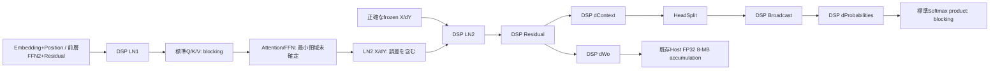

# G1 FP32 Attention MatMul・LN1 Forward feasibility

## 結論・適用範囲

dProbabilitiesまで下流frontierを進めた。DSP LN2→Residual→dContext→HeadSplit→Gate→DSP dProbabilitiesは、同一binaryの3独立processで25ケースすべての既存gateを維持した。最終最大誤差は3.30738517277e-4。Receipt/Tapを除去したvariantも同じ最終wordsだった。

既存DSP LayerNorm ForwardをLN1に再利用できる。Reference-fed D64/T32の44ケースでY/xhat/inverseとnative saved state→Backwardが合格した。しかしLN1の入力producer断片と次の標準Q/K/V projectionに独立した障害が残る。LN1の置換だけでは実G1上流を修復できない。

40-node上流graphのTap差は再現した。Receipt有無だけでは共有可視tensorのwordsが変わらず、float APP_READ/NATIVEの変更で結果が変わった。6-node FFN対照ではTap差を再現できず、逆順のgraph構築でも値は変わらなかった。backend lowering・memory placement・kernel selectionの内部原因と最小再現graphは未確定。

分類:

- **DSP_DPROBABILITIES_MATMUL_VERIFIED** — T32/H2/Dhead32の診断geometry。
- **FP32_ATTENTION_DPROBABILITIES_SEGMENT_VERIFIED** — LN2 X/dYとForward saved Gate/V/Pがreference-fedの範囲。
- **DSP_LN1_FORWARD_VERIFIED** — 正確なFP32 Xを渡したD64/T32。
- **OBSERVER_FREE_PRECISION_VERIFIED** — Custom下流segmentの出力、LN1のnative saved state→Backward。全G1 graphへの認定ではない。
- **BLOCKED_ATTENTION_CONSUMER** — 次の標準Softmax backward Multiply。
- **BLOCKED_LN1_INPUT_PRECISION** — checkpoint由来の前層FFN2＋Residual producer断片。
- **BLOCKED_LN1_CONSUMER** — 標準Q/K/V projection、事前登録0.002 stage gate。
- **FP32_ARCHITECTURE_REASSESSMENT_REQUIRED**。
- **UNRESOLVED** — 全19層の最小FP32領域、Tap内部原因、production scheduling/throughput。

全Attention移植、全19層Custom統合、production builder変更、G1 training updateは0。40k→60k/200kは**NO-GO**。6031は別incidentの**UNRESOLVED / DORMANT / WATCH**を維持する。

## A. Reuse auditと実際の契約

研究baseは`0cf0585f37cbe10081d0cf57abf203ae70f26dac`。開始時は前研究branch、clean tree、upstreamなし。未pushの前研究commitとprivate evidenceを正とし、指定branchをそこから作成した。前回の最終sourceは`a3eed5b144f19b61e4cb12ca41a8e5106f0b8b03`、DSP packageは`f9d6cd62ef85720e7283efbfa96e8ff3f2e55a44d97848f88c478661d66d1f4d`、probeは`54822d1a592b5a06c00412f3350188e4ec764f84a319aaa29c204274b4a7efe0`。前回のfrozen binaryと5保護artifactのhashを照合して保持した。

Source正本は[`qnn_runtime_transformer_training_generalized.inc`](../app/src/main/cpp/qnn/qnn_runtime_transformer_training_generalized.inc)、共通LN emitterは[`qnn_runtime_transformer_training.inc`](../app/src/main/cpp/qnn/qnn_runtime_transformer_training.inc)。productionのrank2 activations/rank1 parametersを診断ではunit leading axes付きrank4へ写像する。物理配列はrow-major、batch=1。productionと同一のloweringを証明したとは扱わない。

| Tensor | Producer・shape・consumer |
| --- | --- |
| DRESIDUAL1 | DSP LN2 dX＋residual upstream、T32×D64 |
| dContext | DRESIDUAL1 Woᵀ、32×64 |
| selected_h | lossless HeadSplit、`dc[r*64+h*32+c]`、32×32 |
| head dContext | selected_h[r,c]×gate_h[r,0]、32×32 |
| gate_h | Forward Sigmoid(LN1 Wg)のhead selector、32×1 |
| V_h | Forward value projectionのhead selector、32×32 |
| dProbabilities_h | head dContext V_hᵀ、32×32。reduction dimension=32 |
| P_h | Forward causal-mask適用後のSoftmax saved probabilities |
| softmax_product_h | dProbabilities_h×P_h、同shapeのelementwise Multiply |
| softmax_dot_h | productの最後のaxis ReduceSum、32×1 |
| softmax_centered_h | dProbabilities_h−dot_h、row broadcast |
| dScores_h | P_h×centered_h |

元のdProbabilitiesは`qti.aisw/MatMul`、transpose_in0=false、transpose_in1=true。H2は2つの独立head。診断Customは1 launchにまとめるがhead間の混合・転置・mask追加を行わない。式は`Y_h[r,j]=Σ(q=0..31) A_h[r,q] V_h[j,q]`。maskはこのMatMulの入力加工ではなく、saved Pと後続Softmax backwardに関係する。Gate自体への微分、dValue=PᵀdContextは別分岐である。

[`custom_matmul_ops.h`](../host_tests/fp32_custom/custom_matmul_ops.h)の既存2geometryからordered FP32 dotを抽出し、同じ関数をdContext/dWo/dProbabilitiesで使用した。q順は増加順、multiplyはvolatile floatへ丸め、その後float加算。`-ffp-contract=off`、DSP auto-vectorization disabled。FP32 accumulationを宣言dtypeから推定していない。

新しい数学はdProbabilitiesの固定geometryのみ。[`attention_matmul_op.h`](../host_tests/fp32_custom/attention_matmul_op.h)が4 inputs A0/A1/V0/V1、2 FP32 outputsと6152-word INT32 receiptを登録する。receiptは8 header＋4096 input words＋2048 output words。DSP markerは0x4838310b。DDR_DIRECT/FLAT_4、V81 worker、動的scratchなし。

QHPI interface v1.4は維持、既存Op名・output count・receipt layoutは維持。packageの登録Op数は11→21。追加10名はdProbabilities observed/freeの2名と既存OpのNoReceipt 8名で、新規数学kernelが10種類増えたという意味ではない。NoReceipt specializationはreceipt copy・counter・output registrationをコンパイル時に除去する。裏でreceiptを作って隠す方式ではない。全てdiagnostic-only/default-off、production/Muon/optimizer/codec/data orderは未変更。

## B. dProbabilitiesの数値結果

25既存case（24 frozen＋full upstream=1）と10非対称case。ordinary、low variance、constant、mixed signs、cancellation、small/large、head別係数、fixed-seed random、offsetを含む。前研究の失敗は同じfrozen stateから再構成した。既存deviceの0.57522 worst caseはnative standard controlでも再現した。

Double analytic referenceと別のHost ordered FP32 referenceを使用。Standaloneとnative chainの判定を分離した。standalone DSPの出力は、その受信入力を使ったFP32 referenceと全word一致。Host mockも70実行でPASS、maxAbs=2.27423882961e-4。既存caseのAは各probe runtimeのLN oracleから再構成するため、Windows mockとAndroid probeをraw A wordsが同じ検証と扱わない。実機3 processでは同じprobe・同じrecipe/fixture identityを固定し、raw operandsをreceiptで確認した。Host mock値を実機値へ転用しない。

| 実機経路 | Head0 maxAbs | Head1 maxAbs | gate・失敗数/process |
| --- | ---: | ---: | --- |
| Standalone DSP、receiptあり | 1.31436614993e-4 | 2.13212845324e-4 | 0.01、0/35ずつ |
| Standalone DSP、receiptなし | 同上 | 同上 | 0/35、FP words exact |
| Standalone standard HTP | 0.345726128538 | 0.575201956607 | 10/35、11/35 FAIL |
| Native DSP LN2→dProbabilities | 1.86749671570e-4 | 3.30738517277e-4 | 0/25ずつ |
| Native chain、float Tap | 同上 | 同上 | 0/25 |
| Receipt/TapなしCustom chain | 同上 | 同上 | 0/25、同じ最終words |
| GateまでCustom→standard dProbabilities | 0.345791101721 | 0.575221524983 | 8/25ずつ FAIL |

同じnative fixtureでhead1最大誤差は約1739倍小さくなった。DSP LN2 Forward/Backwardが生成したdXを使用し、理想的dContext/Gate gradientのHost注入は行っていない。ただしLN2へのX/dY、gate係数、V/Pは正しいfrozen external inputsであり、HTPが作ったForward saved stateの精度まで認定していない。

全前段のLN .02、dContext/dWo .03、Gate .01、Forward/split .002 gateを維持した。LN2 Yはfloat-Tap variantで測定し、完全TapなしのNATIVE Yは直接観測しない。Backwardが受けるnative xhat/inverseはreceiptで双方のwordsを比較した。Native producer/consumerのreceipt入力と出力を全要素比較し、受信operandから独立に計算したFP32 dProbabilitiesともword一致を確認した。Float Tap追加、receipt除去、後続consumer追加でCustom dProbabilitiesのwordsは変化しなかった。

### 次のfrontier

追加したのは既存HTPのSoftmax backward 4演算/headだけ。これ以降のCustom arithmeticは実装していない。

| 次段、Tap付き | Head0 maxAbs / FAIL | Head1 maxAbs / FAIL | 事前gate |
| --- | ---: | ---: | ---: |
| softmax_product Multiply | 0.0567297886163 / 6 | 0.0435456876784 / 5 | 0.005 |
| dScores、Tapなし | 0.0560203321422 / 9 | 0.0634557750209 / 7 | 0.002 |

最初の測定済みFAILは同shape Multiply。dot/centeredも累積誤差を持つが、正しいproductを渡して再検証していないので、それら全てに独立したCustom化が必要とは断定しない。次の最小試行は既存Custom Multiplyの再利用。2 headの同時launchでは既存共通receipt counterの安全性も監査し、旧ABIを保持したpaired geometryまたはcounter分離を検討する。その後、正確なproductを受けるReduceSumの独立gateを調べる。Softmax backward領域のfusionは設計候補として停止した。

## C. LN1 Forwardと入力producer

LN1とLN2は同じLN emitter、gamma/beta shape D64、epsilon=1e-5、centeredScale=1/adaptiveScale=false。LN1はlayer input→mean→centered→square→variance→epsilon→inverse→xhat→gamma→betaで、次はQ/K/Vとgate logits。xhatとinverseはBackwardまで保持するnative stateで、gamma/betaはparameter lifetime。

旧研究の固定X起点で、ReduceMeanが最初のFP32 word不一致、Squareが最初の0.002 stage budget超過だった。これは今回の入力producerからの最初の損失点とは別の主張である。

比較Aは元の11-node HTP LN1、Bは独立double meanをFP32へ丸めたrow値を展開し、既存Custom Addでcenteredだけ修正した限定control、Cは既存DSP LnForward全体。BはDSP ReduceMeanの実装でもproduction候補でもない。LN1全体の再利用を優先し、新しいLN1専用数学kernelは作らなかった。

24 source-derived case＋20既存redesign caseの44 case。T32/D64、constant、low variance、1024 large-offset、以前のSquare failure、512/4096、fixed-seed randomを含む。

| 経路 | Y | xhat | inverse | 結果 |
| --- | ---: | ---: | ---: | --- |
| Original HTP | 25/44 FAIL | 33/44 FAIL | 31/44 FAIL | 各8 caseがnonfinite |
| Partial centering control | 15/44 FAIL | 22/44 FAIL | 31/44 FAIL | 各8 caseがnonfinite |
| DSP LN1、Reference-fed | 5.81823561774e-7 | 6.66749372158e-7 | 1.94379752543e-5 | 全44 PASS、gate=.002 |
| DSP saved state→Backward | dX 1.53640447422e-5 | native xhat/inverse words一致 | dGamma/dBetaもPASS | gate=.02 |

Anchor-relative centering、compensated sums、scaled RMS、hypot denominatorを維持した。DSPは全required output有限。標準negative controlのnonfiniteを成功に含めない。最初のpilotはこのnonfinite検査で中断し、完了時cleanupなしのprocess faultも記録した。修正版ではcontrolだけnonfiniteをFAILとして保存し、Custom有限性・API・poison・canary検査はfail closedのまま。pilotは最終cohortから除外した。

Reference-fedのreceiptあり2variantではraw X/gamma/beta/epsilon/dY、Forward xhat/inverseとBackward受信wordsを全要素確認した。receiptなし、native saved stateでもdX/dGamma/dBetaは全44 PASS。内部centeredはkernelのlocal arrayで出力されないため、独立したdevice centered tensor精度を測定したとは主張しない。Forward YがNATIVEのvariantではY自体は直接観測せず、saved-state gradientsとQ/K/V最終値を検証した。

### Reference-fedとHTP-produced

新しいprivate producer fixtureは保護checkpointをread-only decodeし、既存CPU traceとのX全word一致を確認した。16 synthetic caseは実G1のEmbedding MatMul＋固定sinusoidal Position Add、8 checkpoint-derived caseはCPU traceの前層ReLU/W2/Residual1を外部入力し、実G1のFFN2 MatMul＋Residual AddだけをHTPで実行した。全19層のHTP Forwardを実行した証拠ではない。

| LN1 X producer断片 | X誤差 | Ideal LN1 Y誤差 | Ideal LN1 dX誤差 | DSP受信Xに対するlocal精度 |
| --- | ---: | ---: | ---: | --- |
| Embedding＋Position、16 case | 1.360476017e-4、0/16 FAIL | 0.00135902915291、PASS | 0.00404261335983、PASS | 全PASS |
| 前層FFN2＋Residual、8 case | 0.00517416000366、8/8 FAIL | 0.00209741522378、1/8 FAIL | 0.0240633507995、1/8 FAIL | Y 1.82530962789e-7、dX 2.61244586852e-6、全PASS |

X stage予算=.002、Y=.002、dX=.02はDevice観測前から固定。Tap XとDSP受信X receiptはword一致。従ってこのfixtureではHTP producerで失われた情報をDSP LN1は復元できない。FFN2とResidual Addのどちらが最初に予算を超えるか、operand conversion/accumulation/storeの内部配分は未確定。最低限このproducer断片のprecision-preserving boundaryが必要で、FFN Forward全体の移植へ拡張しない。

### LN1の次のconsumer

正確なDSP LN1 Yを次の実G1標準MatMulへ接続しても、Q/K/Vはそれぞれ0.00398001603026、0.00393137469602、0.00807027776229で0.002 stage gateを超える。44 caseで8/8/16 FAIL。Tap/receiptなしvariantでも同じ結果だった。native saved state保持の成功と、標準Forward consumerへの復帰成功を区別する。gate-logits projectionと全Attention Forwardの最小領域は未検証。

## D. Observer effect

最初のcohortではLN2 Yが追加APP_READとして残っていたため、完全なobserver-free証拠には採用しなかった。package binaryを再利用し、probeだけを再buildして、TapなしのYもNATIVEへ変更した全Lane9 processを最終cohortとした。前cohort/pilotはprivateに別保存し、digest/timingへ混ぜない。

4条件を独立に作成。0=Tapなし/receiptあり、1=Tapあり/receiptあり、2=Tapなし/receiptなし、3=Tapあり/receiptなし。ReceiptなしはINT32 tensorを登録せず、NoReceipt kernelを使用する。float Tapだけの比較は同じnode数/tensor数/op数学、APP_READとNATIVEの差である。receipt比較ではsignature/Op type/memory payloadも変わるので、hidden backend loweringを完全固定した実験ではない。

| 上流40-node graph | X maxAbs | dY maxAbs | Context maxAbs |
| --- | ---: | ---: | ---: |
| Tapなし、receiptあり | 0.222915754803 | 36.9745414304 | 0.0438406596457 |
| Tapあり、receiptあり | 0.0541295814214 | 2.79020669831 | 0.0120256085265 |
| Tapあり、receiptなし | 同上 | 同上 | 同上 |

Tapなし/receiptなしではX/dY/contextの内部wordsを観測しない。dWo/dGamma/dBeta最終wordsはTapなし/receiptありと一致した。Tapありの全共有可視値もreceipt除去でword不変。Tapを変えると比較可能6 tensor中138/150 comparisonsが変化し、下流parameter gradientまで含む最大差は43.9532470703。3 processで同じ差が再現した。

最初に両variantで観測可能な相違はContextなどの上流出力。40-node内部の最初の相違opをlocalizeしたとは扱わない。receiptコピー/カウンタだけが主要原因という仮説は、この比較と168 Host kernel pairsのword一致では支持されなかった。float observabilityの変更が数値差を引き起こすことは確認したが、fusion・memory placement・kernel choice・schedulingのどれが機構かは未確定。

限定FFN backwardはFF1、DRELU、Greater、Select、dY MatMul、Copyの6 nodes。4 observer条件と逆順構築の8 graphで、25 caseのdY wordsは全て同じだった。Tap差の最小再現にはならなかった。一方DRELUの独立入力誤差0.0268393417376（7/25）、dY 0.0434901324345（6/25）が残った。したがって40-nodeで観測された最大36.97の差を、この独立FFN fragmentだけに帰属できない。

Custom LN2→dProbabilitiesではobserver-free accuracyが成立した。HTP-produced上流を含む全体はTapありでも必要accuracyを満たさないため、「Tap付きで全G1 PASS、外すとFAIL」とは報告しない。数値再現性、bitwise一致、required accuracyを別判定にした。

## E. Coverage map

以下は診断payloadの認定で、production19層全体の認定ではない。V=VERIFIED_CUSTOM_FP32、S=VERIFIED_STANDARD_HTP、B=BLOCKED_STANDARD_HTP、U=UNTESTED、R=STRUCTURAL_ONLY、I=INTEGRATION_UNRESOLVED。

| Forward領域 | 分類 | 証拠の限界 |
| --- | --- | --- |
| Embedding＋Position producer断片 | S（合成16 caseのX予算） | 各単独op・全checkpoint embeddingはU |
| LN1 | V | Reference-fed、producer errorは別 |
| Q/K/V projection | B | 正確なDSP LN1からでもstage FAIL |
| gate logits/Sigmoid | R/I | source依存確認、全native精度は未認定 |
| Attention scores・mask・Softmax | R/I | 上流micrograph内のtap測定、独立合格ではない |
| Attention context・output projection | B/I | composite X/contextの誤差、個別blocking分解は未完 |
| Residual before LN1 | B/I | FFN2＋Add断片、最初の個別opは未確定 |
| LN2 | V | 正確な入力への局所精度 |
| FFN Forward | B/I | bounded producerだけ、全領域は未認定 |
| Final logits | U | 今回検証せず |

| Backward領域 | 分類 | 証拠の限界 |
| --- | --- | --- |
| LN2・Residual | V | reference-fed X/dYで連続 |
| dWo・dContext | V | 既存.03 gate維持 |
| HeadSplit・Gate | V | copy words exact、Gate .01 |
| dProbabilities | V、標準版B | paired-head geometryのみ |
| Softmax backward product | B | 正確なCustom dProbabilitiesからFAIL |
| dot・centered・dScores | B/I | product誤差の伝播を含む、個別必要Custom範囲はI |
| dValue | S（前研究の.01） | 今回は全branch統合せず |
| dQ/dK、head scatter、projection gradients | U/I | 今回Custom移植せず |
| LN1 backward | V（saved-state local診断）/I（実下流接続） | dYを全Attentionからnative生成した証拠ではない |
| FFN backward | B/I | DRELU独立入力FAIL、全最小領域はI |
| Embedding gradient・lower-layer path | U | 全1-layer backward未認定 |
| Gradient materialization・8-MB accumulation | V/S（前研究を継承） | 既存Host FP32 accumulation4.87e-6、今回full registry再統合なし |

単一の完全な最小FP32 domainは未確定。現在の最小**実証済み**下流domainはLN2からdProbabilitiesまで。上流にはLN1の原子的置換だけでなく、projectionと入力producer boundaryの対処が必要である。

## F. 性能・engineering cost

非exclusive BACKGROUND_CORRECTNESS、D64/T32/H2、同じfrozen fixture0。各processの9反復の先頭をwarmupとして除外、残り8のmedian。電源/熱条件・Host allocation・receipt通信を含むdiagnostic値である。

| Variant | 3 processのexecute wall median | dProb math median | dProb full kernel window |
| --- | --- | --- | --- |
| Native、receiptあり | 11.898–12.100 ms | 1.988–1.991 ms | 2.140–2.145 ms |
| Tap、receiptあり | 12.176–12.359 ms | 1.990–1.995 ms | 2.140–2.147 ms |
| Native、receiptなし | 11.216–11.418 ms | 未観測 | 未観測 |
| Tap、receiptなし | 11.353–11.555 ms | 未観測 | 未観測 |

receiptなしのqtimer欄0は未測定sentinelで、kernelが0時間という意味ではない。純粋なstandalone数学とintegrated execute wall、Host allocation/copy/APIログ時間を混同しない。LN1 Forward receipt timerは88 calls/processのmedian454.5–455us、range394–509us。これはinput receipt後のscalar normalization＋saved-state storeを含むwindowで、純数学だけではない。

Graph finalizeはLane Aの11 graphでmedian41.132–44.251ms（全range24.459–66.730ms）、LN1の10 graphで42.030–44.284ms（最大169.032msの非exclusive outlier）、Observerの12 graphで49.648–52.542ms。graphごとにnodes/payloadが異なるので、集団medianをproduction finalize予測にしない。固定context内に複数graphを保持し、最後にcontext/device/backendを明示解放した。context identityはprivate evidenceに残し、同一context内と3 independent processを区別した。

| Custom数学 | scalar work / 1 layer・1 MB | FP32 unique payload | scratch / state |
| --- | --- | --- | --- |
| LN Forward | rows32×channels64、複数compensated reduction・sqrt/hypot | X/Y/xhat8192Bずつ＋inverse128B＋params | centered[128]=512B stack、saved8320B |
| LN Backward | row reduction＋dGamma/dBeta reduction | dY/dX/xhat8192B、inverse128B | 2×Sum[128]≈2048B stack |
| Residual Add | 2048 adds | 2 inputs＋output=24576B | dynamic scratch0 |
| dContext | 131072 MAC | inputs24576B＋output8192B | dynamic scratch0 |
| dWo | 131072 MAC | inputs16384B＋output16384B | dynamic scratch0 |
| HeadSplit | 2048 copied words | input/output計16384B | dynamic scratch0 |
| Broadcast | 2048 multiplies | 16640B | dynamic scratch0 |
| paired dProbabilities | 65536 MAC＝131072 mul/add FLOP | 16384B inputs＋8192B outputs | dynamic scratch0 |

dProbabilitiesだけのreceiptは24608B、約151usの追加validation/copy windowを含む。naive scalar load命令からの数学的traffic推定はdProb532480B、dContext1056768B、dWo1064960B、計2654208B/layer/MB。cache reuseを無視したload volumeであり、実DDR trafficの測定値ではない。physical DDR/VTCM、runtime workspace、kernel schedulingは未測定。QHPI_RESOURCE_HVX登録はHVX vector arithmetic実行の証拠ではなく、今回のkernelはscalar。

| graph | QNN nodes | tensors | logical bytes | native FP tensors |
| --- | ---: | ---: | ---: | ---: |
| Native LN2→dProb、receiptあり | 8 | 41 | 363472 | 10 |
| Native LN2→dProb、receiptなし | 8 | 33 | 165260 | 10 |
| ＋標準Softmax backward | 16 | 49 | 388304 | Tap依存 |
| 標準dProb/dValue control | 11 | 42 | 347056 | Tap依存 |
| 上流observer、receiptあり | 40 | 70 | 593536 | Tap依存 |
| 上流observer、receiptなし | 40 | 65 | 453020 | Tap依存 |

8-node domainは8 kernel launchesで、dWo分岐を含む。native FP tensors10のうちYはBackwardの下流では未使用のForward outputで、完全TapなしではこれもNATIVEに保持する。logical bytesはdeclared tensor countの合計で、liveness reuse・guard・Host snapshots・runtime workspaceを含まない。NoReceiptで198212B/domain減ったことはlogical payloadの差である。

Sourceはcompactな診断実装。new dProb registration/kernel header37 lines、shared MatMul50 lines、LN89 lines、observer specializationは既存bodyへのcompile-time guard。行数だけではABI count、shape constraints、reference/fixture、consumer receipt、lifecycle/test維持の工数を表さない。新規source/test/probeと既存変更の実際の差分はbranch commitで固定する。旧Opの回帰を保つHost kernel testsはdContext/dWo136＋LN chain68、Broadcast35、observer168 pairs、new MatMul70、shape validator2096 checks。

### 19-layerの算術・memory概算

19層へ同geometryを置いた仮定だけを計算し、実装は行っていない。8-node domainは152 nodes、779 declared tensors、receiptあり6905968 logical B、receiptなし3139940 logical B。3 MatMulは6225920 MAC/MB、8 MBで49807360 MAC。dProbabilities追加分だけは1245184 MAC/MB、8 MBで9961472 MAC。

LN1/LN2両Forwardのsaved xhat/inverseは316160B/19 layers。8 MBを同時保持する仮定では2529280Bだが、逐次MBなら8倍のsaved stateは必須ではない。dWo outputs311296B、8同時materializationsなら2490368B。lifetime/recompute/fusionで実占有は変わる。

原G1 estimatorはH2/G1で56 Forward＋90 Backward nodes/layer、Adamを除く19-layer explicit graphは2783 nodes。数学単位で両LN Forward22、LN2 Backward13、Residual1、dContext/dWo2、head selectors2、gate multiply2、dProb2の計44/146（約30%）に局所診断証拠がある。LN1 Backward局所control13を加えると57/146（約39%）だが、全Attention dYとの実接続は未認定。node-equivalent比率はFLOP比率・時間比率・全graph correctness率ではない。

今回のdProb約2ms、既存scalar MatMulの過去約3.9–4.1msは、elementwise Broadcast約76–78usより大きい。現在の診断geometryではMatMulが主要コスト候補という測定根拠がある。旧LN2 segment約9.7msは異なるinstrumentation条件であり、今回wallから直接差し引かない。実測wallを19/38/304/608倍してproduction throughputとは呼ばない。transfer、MB scheduling、同時実行、DDR contention、thermal、Fusion後のkernel時間は未測定。

### 最適化の設計候補

q順を維持してoutput columnsをparallelにするとordered FP32契約を保てる可能性がある。HVX128Bは32 FP32 lanes、paired dProbは65536 scalar MACを理想上2048 vector multiply/add stepsへ対応できる。ただし32倍はlane数の上限で、speedup予測ではない。right-transposed Bをq-majorへ事前transposeするなら両headで8192B scratchが増え、transpose trafficとlaunchを評価する必要がある。dContextではWo transpose16384B、dWoはBが元からcolumn-vector化に適したrow layout。blockingでoperand reuseを増やす余地がある。

SDK19.0.07のHVX headerにはsf multiply/add intrinsicsが存在する。しかしordered rounding、FMA不使用、subnormal、accuracy/receipt一致は新たに実機検証が必要。q方向のparallel reductionは加算順を変えるので、単なる速度変更ではない。LNのcompensated reductions/sqrt/hypotも精度条件を先に保つ必要がある。本格vectorization/fusionは今回実施していない。

## G. Architecture decision

| 方式 | 今回の証拠に対する判断 |
| --- | --- |
| A Surgical Custom | 再利用が速く、必要性を局所的に実証できる。ただしLN1→projection、Gate→dProb、dProb→Softmax、前層FFN→LN1と境界ごとに障害が再発。個別Opを増やすだけではcomplete training domainが収束していない。 |
| B Larger DSP FP32 segments | 次の投資先として推奨。LN全体の既存kernel再利用が成功した例に倣い、native FP32 ownership・saved state・observer-free contractをsegment単位で設計する。既存kernelを再利用し、数学を無制限に追加しない。MatMul/softmax間の融合は中間8KiB traffic/launch削減候補だが速度・scratchは要実測。 |
| C Wider FP32 backend | 現時点では評価のみ。全1-layer correctness、全19層のprecision requirement、production timingが欠ける。HTPを全面置換する費用を正当化する証拠はまだ不足。 |

次の判断を明確にする。

1. dProbabilities standaloneは合格。DSP FP32 reference wordsも一致。
2. DSP LN2からのnative segmentも合格。前段gate維持、3 process一致。
3. 次のblockingは標準Softmax product Multiply。以降の全演算の独立必要性は未確定。
4. 既存DSP LayerNorm ForwardはLN1に再利用できる。
5. LN1より前の情報損失は解消していない。checkpoint producer断片で入力・最終dXに予算超過がある。
6. Tap差の因果要因はfloat observability変更。backend内部機構・最小再現は未確定。receipt除去だけでは差がない。
7. observer-free Custom下流domainは合格。HTP-produced全上流は必要精度を満たさない。
8. 局所数学証拠はnode-equivalent約30%、LN1 backward localを含め約39%。全1-layer認定率ではない。
9. Surgical方式は最小診断・再利用に継続使用する。productionの主設計として単独Op追加を続ける判断は保留。
10. Larger segmentへの設計投資を推奨。まずSoftmax backward boundaryとLN1/projection boundaryを別々に測る。
11. 次の最小試行は既存Custom Multiplyでsoftmax_productを置換し、正確なproductに対するReduceSumを検証すること。新しいprojection NN geometryも既存dot再利用候補だが、Forward移植へ拡大する前に費用gateを置く。
12. 40k→60k/200kはNO-GO。full1-layer backward、HTP-produced upstream、全gradient materialization、observer-free full graphが未成立。

設計見直しのtriggerは既に満たした。Forward/Backward双方の独立境界でblockingが再発し、約3分の1のnode-equivalentに局所FP32証拠が広がったためである。今後は共通shape/indexing、segment lifetime、ABI version、reference independence、negative tests、frozen binary cohortを設計単位にする。バイブコーディングで個別kernelを追加しやすいことと、ABI/ownershipを安全に維持できることを区別する。全演算をCustomへ置換する計画は採用しない。

## H. Provenance・validation

- Branch: `investigation/g1-fp32-attention-ln1-frontier`。
- Working tree: clean。数値cohort前とcloseout後の`git status --porcelain`が空であることを確認。生成binary/private evidenceはignoredなbuild領域に保持した。
- Device-tested source/probe commit: `ba128e3d338ed57b1a2b86b0df3b43d100de874f`。DSP/Host packageは`02eda90071825a6bbe43c578d77e4a4a5d73d1cb`のbytesを再利用した。全package source hashes・compiler hashes・SDK identityをProbeOnly guardで照合し、package arithmeticの差は0。
- Final HEAD: 本レポートを含むcommit。`git log -1 --format=%H -- docs/g1-fp32-attention-matmul-ln1-feasibility.md`で取得でき、exact hashはcloseout private ledgerと完了回答にも残す。以後の変更はexporter/evidence/docのみで、numerical source/binaryへ転用しない。
- QAIRT `2.48.40.260702151143`、QNN API `2.37.0`、HTP V81、Hexagon SDK `6.6.0.0`、tools `19.0.07`、NDK `26.2.11394342`。
- DSP package SHA256: `c32a0aadb453d7f7440ad9ea0d76bd30b502dc80f0e03a6a0799a26881e33927`。
- Host preparation package: `75e98ade31cd247d3735059b30a58ba481a7205630bbb2ab3d951bf0b3196f30`。
- Probe: `db6555f0cd79f6ae67ad9cdb91176dea80ad48e3f0bd9a4c13fd4f175f09738a`。
- Hexagon compiler: `039c2fc1840b06a3601fa63972d86d1b575d7a1afeae2f3504a1843df147c047`。
- NDK compiler: `ce4566f8c00c9d36d2724bd4af6a2714d8daed1c09f2290d7c4751a766fbb7b3`。
- Frozen one-layer fixture: `388f4d8b30b86997d2f03f732e5a3210f7e2b3015af883579e3f0659df9d9f4f`。
- LN1 parameters: `7102ec13544df457922942e3282b15a8612da91c51156692000fc0dd0a21f97f`。
- New producer fixture: `ee9e3185b9a5857d874b5791a1e4b34c153401367dc208a1b74fa3bafa1a9580`。

| 最終cohort、各3独立process | executes/process | metrics/process | canonical numerical SHA256 |
| --- | ---: | ---: | --- |
| Lane A | 341 | 3135 | 3d2b95c3c02898974911f463d7f1eec8cfe7c3c32c6e649aa23869f051192e18 |
| LN1 | 312 | 2552 | c8823fcee6e324357da663812431d73d4bf86cd0716c859b6dee810d09ce6f7c |
| Observer | 300 | 925 | 15465280cd867df527eeec714eec3d16e802dd8267307e2687324abdb492677c |

最終9 processで同じpackage/probe/runtime/fixture identity、API return0、required outputs finite、poison/canary、input immutability、receipt word checks、CPU fallback absence、context/device/backend teardownを確認した。canonical digestは数値metricsとobserver differencesを順序付きでhashし、timingやcall countersを除外する。同じgraph configuration内の再現性を示し、異なるgraphのbitwise不変性は別比較で確認した。標準nonfinite controlはFAILとして保存した。

実行ごとにdevice identity、Awake、top-resumed、active absence、Host20GiB/device12GiB、thermal/battery、APK audit、staged SDK/Skel/package/probe hashesと保護5artifactをguardで確認した。smoke前の一度のADB device listing timeoutは実機workloadを開始せず停止し、読み取り専用guardの再確認が成功した後に続行した。W8 closeout wrapperの未設定LASTEXITCODE読取はnative実行後のHost bookkeeping faultで、runner PASSEDと114/114 device reportを別途照合した。無断wake、settings変更、force-stop、training resumeはない。保護40k checkpoint SHA256 `89f197d3085f496a22a9ab4ef2161bf2644ba9311b4571faed55f60a7959243d`を維持。100k baseline/200k UNSTABLE/forensics/data/tokenizer/cache/orderは変更しない。

Validation closeout: **Fast PASS**（strict graph後76.8s）、**Host PASS**（contract＋diagnostic378.7s、追加numerical/shape testsもPASS）、**Qnn PASS**（770.8s、SDK/Host/QNN APK/audit）、**Device smoke PASS**（89.7s）、**Muon W8 114/114 PASS**（maxAbs1.490116119e-8、worst relative L2 4.40269854e-8、cosine1、RPC success、finite、fallback=false）。公開exporterは11破損case拒否/private sentinel除外、Python optimized mode拒否を確認。最後のownership修正はSDK probe rebuild＋Host shape2096 checks＋全Lane同一binary3-processで検証した。

Public evidenceは[`g1-fp32-attention-ln1-summary.json`](results/g1-fp32-attention-ln1-summary.json)、allowlist exporterは[`export_public_attention_ln1.ps1`](../scripts/export_public_attention_ln1.ps1)。private ledger、raw tensor/checkpoint/corpus/device IDs、SDK binaries/logcatはcommitしない。専用branchへのcommitのみ、push/PR/merge/history rewriteなし。
