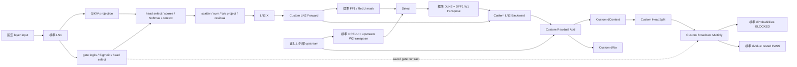

# G1 FP32 Broadcast Multiply & Upstream Precision Frontier

## 結論と範囲

診断用DSP Broadcast Multiplyで下流frontierを1演算進めた。
LN2→Residual→dContext/dWo→HeadSplit→Broadcast Multiplyは、同一binaryの
3独立processで全25 caseの既存accuracy gateを維持した。
次の標準HTP dProbabilities MatMulは最大誤差0.57522で不合格。
同じ分岐点からのdValue MatMulは今回の0.01 gateを通る。

上流では、正しい固定layer inputから標準LN1を調べると、最初の可視word損失は
ReduceMean、最初の事前定義0.002 stage予算超過はSquareだった。
LN1の最終正規化出力も11/25 caseで0.002を超える。
正しいLN1を外部入力してもQ/K/V projectionが不合格なので、LN1だけの置換で
上流全体が直るとはいえない。dY側の独立入力分岐にも標準DRELU MatMulの損失がある。

さらに40/51-node上流graphではfloat tap有無でX/dYが変わる。
この差は3 processで再現し、receiptで実際に受信した値に対するCustom LN2精度は
両variantとも合格した。失われた理想上流値が復元されたという意味ではない。
最小の**完全な**上流FP32領域とproduction loweringは未確定である。

分類:

- **FP32_BROADCAST_MULTIPLY_VERIFIED**
- **FP32_ATTENTION_GATE_SEGMENT_VERIFIED** — reference-fed LN2 X/dYとsaved gateを使う診断segment
- **BLOCKED_ATTENTION_CONSUMER** — dProbabilities MatMul
- **UPSTREAM_FIRST_LOSS_LOCALIZED** — 固定layer inputからのLN1 prefix領域に限定
- **BLOCKED_UPSTREAM_PRECISION**
- **FP32_SCOPE_EXPANSION_REQUIRED** — 必須精度を満たさない境界の追加対処が必要
- **UNRESOLVED** — 上流observer/order要因、全19層の最初の損失点、完全な最小領域、production性能

全Attention移植、全19層Custom統合、optimizer/checkpoint/data order変更、training updateは0。
40k→60k、200k再開は引き続き**NO-GO**。

## A. Source-derived contract

正本は`qnn_runtime_transformer_training_generalized.inc`のForward/Backward emission。
production activationsのrank2を診断ではunit leading dimensions付きrank4へ写像する。
gamma/betaのproduction parameterはrank1 `[64]`、診断では`[1,1,1,64]`。
数式・行優先物理配列は一致するが、productionとbyte-identicalなgraphではない。

| Tensor | Shape / index | Producer / consumer | 所有と寿命 |
| --- | --- | --- | --- |
| LN1 | T32×D64 | layer inputのLN1→Q/K/Vとgate logits | production HTP native、Forward saved state |
| gates | T32×H2、`r*2+h` | `Sigmoid(LN1 Wg)`、Wg64×2 | HTP native、Backwardまで保持 |
| gate_h | T32×1 | gates×head one-hot selector2×1 | token係数、Backward Multiplyへ |
| dContext | T32×D64 | `DRESIDUAL1 Woᵀ` | Custom native |
| selected_h | T32×32、`r*32+c` | `dContext[r*64+h*32+c]` | Custom HeadSplitのdisjoint出力 |
| head dContext | T32×32 | `selected_h[r,c] * gate_h[r,0]` | Custom native、次のMatMulへ |
| dProbabilities_h | T32×T32 | `head dContext Vhᵀ` | 標準HTP、Softmax backwardへ |
| dValue_h | T32×32 | `Phᵀ head dContext` | 標準HTP、head scatter/mergeへ |

元のgateは`qti.aisw`の`QNN_OP_ELEMENT_WISE_MULTIPLY`、2 inputs/1 output、scalar paramsなし。
診断shapeは`[1,1,32,32] × [1,1,32,1]`。最後のchannel axisのみbroadcastする。
transpose/stride変更、head/token/channelの並べ替えはない。
HeadSplitのinputは`[1,1,32,64]`、outputsは各`[1,1,32,32]`。

gateは勾配マスクという名前から推定したものではなく、Forwardのheadwise sigmoid。
gate自体への微分は別分岐の`selected_h * raw_context_h`→ReduceSum→scatterである。
今回のBroadcast Multiplyをその分岐の代用にしない。
次のAttention consumerは2つあり、一方だけの結果で両方を合格扱いしない。

診断下流segmentのgateはCPU generalized Forwardのfrozen saved valuesをAPP_WRITEで供給する。
実HTP gate producerからCustom Broadcast Multiplyへの連続接続は未検証。
LN2 X/dYのreference-fed、HTP-produced試験も別graphとして保持している。
production builderにCustom injection hookを追加していない。

## B. Broadcast Multiply実装と単独matrix

既存HexaFp32 QHPI packageへ診断型`BroadcastMultiply`を1つ追加した。
既存Copy/Add/Multiply/LN/MatMul/HeadSplitの数値kernelは変更していない。
production defaultはoff。明示的な`oneBroadcast` diagnosticだけが接続する。

1 launchで両headを処理する。inputsはA0/A1 `[1,1,32,32]`とG0/G1 `[1,1,32,1]`、
outputsはY0/Y1とINT32 receipt4168 words。式は
`Yh[r*32+c] = round32(Ah[r*32+c] * Gh[r])`。
DSPがtoken係数を選ぶため、Hostでgateを1024要素へ展開しない。
scalar FP32、V81、`-O2 -ffp-contract=off -fno-vectorize -fno-slp-vectorize`。
`QHPI_RESOURCE_HVX`登録はHVX vector arithmeticの実装を意味しない。

receiptは8-word header、A0/A1全2048 words、G0/G1全64 words、Y0/Y1全2048 words。
kernel markerはDSPで`0x4838310a`、Host mockは別marker。
shape/dtype/countを検査し、全operandとoutputの有限性をQNN statusとは別に確認する。
全面書き込み、poison/canary、APP_WRITE不変性、独立Host FP32全word一致を検査する。
2 headを1 kernelにまとめ、同種head kernel間の並行receipt counter共有を避けた。
同種kernelを多層/worker間で並行実行するABIはまだ保証していない。

matrixは35 case ×2 heads ×3 processes。
ordinary、low variance、constant、large-offset low variance、mixed signs、near-zero、
cancellation pairs、large/small mixtures、nontrivial coefficients、fixed-seed randomの10 case、
既存failing gateを含む24 frozen case、full upstream=1から派生する1 case。
random seedは`0x31415926`。synthetic matrixでは両headで異なるtoken係数を使用する。
cancellation pairsは符号対gradientであり、このMultiply内にreduction/cancellation演算はない。

独立double積、独立Host FP32積、同一入力の標準HTP Multiplyを比較した。

| Variant | head0 maxAbs double | head1 maxAbs double | 0.01 failures /process |
| --- | ---: | ---: | ---: |
| DSP Broadcast Multiply | 0.000119648903 | 0.000235995278 | 0/70 |
| Standard HTP Multiply | 2.27247201 | 5.02368979 | 14/70 |

Customは全wordがHost scalar FP32 referenceと一致する。
doubleとの差はFP32 store roundingを含む別指標であり、bitwise一致で代用しない。
単独PASSを接続PASSへ転用せず、次の独立segment試験も実施した。

## C. Native Attention segmentと次のconsumer

実DSP LN2 Forwardのsaved xhat/inverseを同graphのDSP Backwardが消費し、
Custom Add、両MatMul、HeadSplit、Broadcast Multiplyへnative tensorsで接続した。
正しいHost dContextをこのchainへ注入していない。
25 caseは16 synthetic generalized state、8 read-only40k parameter-derived layer18 state、
1 full upstream=1 control。人工token rows/gradient recipesであり、実training corpus/trajectoryではない。

| Stage | X-origin double maxAbs | Gate | Failures /25 |
| --- | ---: | ---: | ---: |
| LN Y / xhat | 7.30727e-7 | 0.002 | 0 |
| inverse | 1.31227e-6 | 0.002 | 0 |
| LN dX / dGamma / dBeta | 3.37812e-6 / 3.24221e-5 / 7.89668e-6 | 0.02 | 0 each |
| Residual | 3.76106e-6 | 0.02 | 0 |
| dContext / dWo | 2.47924e-5 / 3.11344e-5 | 0.03 | 0 each |
| HeadSplit head0 / head1 | 2.16166e-5 / 2.47924e-5 | 0.002 | 0 each |
| Broadcast output head0 / head1 | 1.06630e-5 / 1.41317e-5 | 0.01 | 0 each |

HeadSplitのlocal copy errorは0、producer dContext→consumer input全word一致。
split receiptの両head outputとBroadcast receiptのoperand全wordが一致する。
gate receiptもfrozen saved gate32 words/headと一致する。
Broadcast resultは実際の受信operandからの独立scalar FP32積と全word一致する。
native、float tap、次のconsumerを追加したnative/tapの4 graphでCustom部分の値は同一。
新しいfusionは不要だったので実装していない。既存fused LN2の過去PASSは保持する。
整数receipt付きのnativeであり、instrumentation-free production loweringの証明ではない。

| Next standard consumer | head0 maxAbs double | head1 maxAbs double | Failures /25/head |
| --- | ---: | ---: | ---: |
| dProbabilities = gated dContext Vᵀ | 0.345791102 | 0.575221525 | 8 / 8 |
| dValue = Pᵀ gated dContext | 0.00987862206 | 0.00808755456 | 0 / 0 |

受信gate出力を起点とするlocal double referenceでもdProbabilitiesは
0.345727712 /0.575201957、同じ8/25 failures。上流Custom誤差だけでは説明できない。
native/tap consumer outputsは同一word。HTP nodeへのnative tensor ID接続、Customの出力word、
外部V/P不変性を確認したが、標準HTP内部のoperand conversion/accumulation/storeは直接観測できない。
dValueのhead0は0.01に近く、今回のfixture合格を全distributionのmargin保証へ拡張しない。
Softmax backward、dGate別分岐、Q/K derivatives、LN1 backwardはここから先へ移植しなかった。

## D. Upstream precision localization

### 依存とcontrols

LN2 Forward Xは`layer input + AttentionContext Wo`。
AttentionContextはLN1→Q/K/V、head select、scores/scale/mask/Softmax、context、saved gate、scatter/sum。
LN2 Backward dYは`Select(FF1>0, upstream W2ᵀ, 0) W1ᵀ`。
FF1はLN2 Y W1。Gamma/Betaはその層のgamma2/beta2、Forward保存値はCustom xhat/inverse。
Residual Addのもう一方のoperandは同じlayer-output upstreamである。
これらはすべてdeclared FLOAT32。標準HTP内部の精度をFLOAT32と断定しない。
weights/parametersはForward/Backward共通のimmutable inputs、saved tensorsはBackwardまで保持、
勾配はnative接続またはAPP_READ materializationへ出る。

layer18のproduction tensor名と診断aliasの対応:

| Production tensor | 診断alias | Shape / domain / reference / lifetime |
| --- | --- | --- |
| `layer_018_residual1` | `x` / `up_x` | 32×64、HTP residual producer→Custom Forward、double upstream reference、Forward入力として消費 |
| `layer_018_dln2` | `dy` / `up_dy` | 32×64、HTP DFF1 W1ᵀ→Custom Backward、double FFN reference、Backward入力として消費 |
| `layer_018_norm2_gamma` / `layer_018_norm2_beta` | `gamma` / `beta` | 64、APP_WRITE immutable parameter、checkpoint/fixture words、graph lifetime |
| `layer_018_ln2_xhat` / `layer_018_ln2_inv` | `xhat` / `inverse` | 32×64 /32×1、Custom saved state、独立LN reference、Backwardまで保持 |
| `layer_018_dresidual1` | `residual` | 32×64、Custom dX+upstream、独立Add reference、dContext/dWoまで保持 |

parameterにはarithmetic producerがなく、Hostから同一FP32 wordsを供給する。
最上層のresidual入力はproduction変数`dOutput`、下層なら次層の`DINPUT`というsource依存を維持する。

独立double upstream oracleを追加し、LN1 external referenceからAttentionとFFN dYまで計算した。
Hostでfrozen FP32 stateとの差は最大3.54447e-6、25 case/1,284,800 finite values。
LN1 gamma1/beta1の追加fixtureは同じ40k checkpointのread-only抽出であり、
24 caseのlayer input/LN1値が既存fixtureと一致することを先に確認した。
full upstream=1 controlは既存case0から決定的に派生させる。

- Reference-fed Custom LN2 control: 正しいX/dYを供給。
- HTP-produced、LN1 reference-fed: 40-node graph、nativeとfloat tap。
- HTP-produced、LN1も標準HTP: 51-node graph、nativeとfloat tap。
- LN1の11 stage: full tapと各stageまでのprefix graphによるfixed-state bisection。
- Q/K/V: direct input、Custom Copy→native input、float-tapped Copyの3 variant、HTP output→Custom Copy receipt。
- Xだけ、dYだけ、両方を差し替えるCustom controlを、native/tap両producer条件で別々に実行。

### 最初の損失とgate超過

LN1のsource通りのmean→center→center_scale1→square→mean variance→eps→rsqrt→unscale1→xhat→gamma→betaを測定。
adaptive scalingはoff、epsilonは既存1e-5。ここでもclamp/epsilon/thresholdを変更していない。
全11 prefix outputsはfull-tap対応outputと全word一致する。
同じ固定state、graph生成順、fresh QNN contextで3 processの結果が一致する。

| LN1 visible stage | maxAbs double | 事前stage予算0.002 failures /25 |
| --- | ---: | ---: |
| ReduceMean | 9.51866e-5 | 0 |
| Center / center_scale | 0.00176821323 | 0 each |
| Square | 0.0135807385 | 8 |
| Variance / variance+eps | 0.000645505247 / 0.000655505247 | 0 each |
| Rsqrt / inverse | 0.00718968860 | 17 each |
| xhat | 0.00439883804 | 19 |
| gamma / beta final output | 0.00257940700 | 11 each |

ReduceMeanは全25 case、各32 wordsがordered Host FP32 meanと不一致。
**最初のword loss、最初のstage予算FAIL、最初のLN1 normalized-output必須FAILは別**である。
中間stageの0.002は事前固定の診断予算。単位/consumer感度が異なるので、そのFAILだけを根拠に
各OpすべてのCustom化が必要とは決めない。LN1最終出力と下流consumerの独立gateを併用する。
標準LN1 mean以前の内部input conversion位置やaccumulation/storeへの原因配分はUNRESOLVED。
以前のsynthetic1024±0.001 Subtractから実G1の最初の損失点を推定していない。

| 正しい外部inputsからの標準operation | maxAbs | Gate | Failures /25 |
| --- | ---: | ---: | ---: |
| Q projection | 0.00397996334 | 0.002 | 8 |
| K projection | 0.00393121186 | 0.002 | 8 |
| V projection | 0.00807023330 | 0.002 | 16 |
| DRELU = upstream W2ᵀ、tap graphの独立入力分岐 | 0.0268393417 | 0.002 stage予算 | 7 |

Q/K/Vの3 variantは全word一致し、Copy input/output receiptは正確。
従って正しいLN1を作るだけではprojectionのblockingも解決しない。
DRELUはX/Attentionに依存しない正しいupstream/weightsからの分岐である。
FF1→mask→Select→DLN2のnative全体における最初のblocking位置の完全なbisectionは未完。
Select/mask誤差とMatMul誤差のnative内配分は確定しない。

### LN2到達値とobserver effect

| Producer condition | AttentionContext maxAbs | X maxAbs | dY maxAbs |
| --- | ---: | ---: | ---: |
| LN1 reference-fed、float tap、double oracle | 0.0120256085 | 0.0541295814 | 2.79020670 |
| LN1 reference-fed、float tapなし、double oracle | 0.0438406596 | 0.222915755 | 36.9745414 |
| LN1 HTP-produced、float tapなし | 0.0516534286 | 0.221939227 | 36.9745414 |

最後のrowのoracleはdouble LN1 outputを明示的にFP32 storeしてから独立double上流計算へ渡す。
無限精度19層oracleではない。この境界丸めとHTPによる大きな損失を混同しない。
tap X/dYは同graphのCustom LN2 input receiptと全word一致する。
float tapなしでもCustom receiptから実際に到達したX/dY/contextを取得できる。

40-node/51-node graphのfloat tap有無で325/350 tensor comparisons/processが異なる。
最大X差0.229492188、dY差36.984375、dContext差30.1435022。
これは3 processで同じword digestを持つ再現可能なgraph差であり、random nondeterminismとは区別する。
float observability、graph lowering、生成順/context内graph配置のどれが原因かは未確定。
生成順は固定し監査したが、全順序permutationの不変性を検証したとは主張しない。
`upstreamObserverFreeLocal`というraw mode名は**float tapなし**の意味で、整数receiptは残る。

受信値を起点に独立double LN2/MatMulを再計算すると、すべてのCustom局所gateはPASS。
51-node float tapなしではdContext3.31046e-5、dWo2.57644e-5、LN dX3.49296e-6。
理想X/dYとの差をCustom LN2 kernelの不良として扱わない。

| Native producerからの差し替え | LN dX maxAbs vs ideal | dContext maxAbs vs ideal | dWo maxAbs vs ideal |
| --- | ---: | ---: | ---: |
| 正しいX、正しいdY | 3.37812e-6 | 2.47924e-5 | 3.11344e-5 |
| HTP Xだけ | 0.495008855 | 5.23622147 | 0.0532566958 |
| HTP dYだけ | 5.97727900 | 30.2737230 | 0.566438956 |
| 両方HTP | 6.00816875 | 30.1396230 | 0.576211853 |

このmatrixではdY損失の寄与が大きい。各差し替えのactual-input局所accuracyは合格。
worst-case maximaは異なるcaseの可能性があるため、列間差を加法的な因果寄与と解釈しない。

## E. FP32 coverageと最小領域

| 領域 | 分類 | 根拠 / 限界 |
| --- | --- | --- |
| Layer inputのproducer、Embedding/Position、下層Forward | STRUCTURAL_ONLY | production依存だけ確認、今回の正しい固定入力以前は未測定 |
| LN1 Forward | BLOCKED_STANDARD_HTP | normalized output11/25 FAIL、meanからword loss |
| Q/K/V Forward projection | BLOCKED_STANDARD_HTP | 正しいLN1の3 variantsでもFAIL |
| 残りAttention Forward/gate producer/FFN上流 | BLOCKED_STANDARD_HTP / INTEGRATION_UNRESOLVED | X/dY必須FAIL、float tap差あり、完全なnative localization未確定 |
| LN2 Forward/Backward | VERIFIED_CUSTOM_FP32 | 正しい入力および各受信値起点の局所gate PASS |
| Residual Add | VERIFIED_CUSTOM_FP32 | 全operand receiptと0.02 gate |
| dContext / dWo | VERIFIED_CUSTOM_FP32 | 0.03 gate、native receipts |
| HeadSplit | VERIFIED_CUSTOM_FP32 | local全word copy一致 |
| Broadcast gate Multiply | VERIFIED_CUSTOM_FP32 | 単独と連続segment、両head0.01 gate |
| dProbabilities MatMul | BLOCKED_STANDARD_HTP | 0.57522、8/25/head FAIL |
| dValue MatMul | VERIFIED_STANDARD_HTP | 今回の25 caseで0.01 PASS、後続scatterは未昇格 |
| Gradient materialization | VERIFIED_CUSTOM_FP32 | 過去native dWo→Copy証拠を維持、今回dWo outputもPASS |
| 8 microbatch Host FP32 accumulation | STRUCTURAL_ONLY（今回） | 過去Host FP32証拠4.87342e-6を保持、source不変、今回実機8-MB再試験はしない |
| LN1 Backward / lower-layer backward / Softmax backward | UNTESTED | 正しい上流からの今回の連続検証は未実施 |
| Production G1へCustom統合 | INTEGRATION_UNRESOLVED | 本番builder不変、rank2/rank4とworker/lifetime統合未実装 |

8-MBは指定分類のCustom/standard HTPへ誤分類できないHost arithmeticであり、
previously verified Host FP32として明記する。今回のFloat32 coverage表は全19層PASS表ではない。

実証済み下流最小領域はLN2→Residual→dContext/dWo→HeadSplit→Broadcast Multiply。
dWo branchは既存materialization/Host accumulationへ戻れる。
dValueは今回のfixturesで標準HTPへ渡せるが、Attention全分岐の安全なreturn pointではない。
dProbabilities側はさらにFP32制御が必要。

上流候補はlayer inputからLN1 Forwardを既存Customで保持し、Q/K/V projectionを精度保持する領域。
しかし、それだけでX/dYが直る証拠はない。gate logits/Sigmoid/selector、context/Softmax、
Wo/residual、FF1/Select、DRELU/DLN2の境界をconsumer感度とともに追加切り分けする必要がある。
既存LnForwardはT32/D64のLN1への再利用候補。
既存MatMulDContextはB-transpose geometryであり、Forward Wq/Wk/Wvをそのまま接続できない。
診断上の正確なweight transposeまたは別Forward geometryが必要で、既存PASSの意味を変更しない。
広いAttention/FFN Custom移植は今回実装していない。

## F. Performance / engineering cost

BACKGROUND_CORRECTNESS、accuracy成立後、同じcase0、warm sample0を除く8 samples/process。
6 final processesはbattery41–42°C、thermal status0、foreground takeover0。
exclusive benchmark、frequency固定、power測定は行っていない。

| Passing graph / kernel | 3 process median range |
| --- | ---: |
| Scalar Broadcast arithmetic qtimer window | 76–78 µs standalone |
| Broadcast full kernel window、receipt/finite込み | 166–169 µs standalone |
| Custom standalone graph execute wall | 2.781–2.809 ms |
| 同一payloadの標準HTP 2 Multiply graph wall | 2.669–2.699 ms |
| Native7-node chain graph wall | 12.870–12.957 ms |
| Float-tapped7-node chain graph wall | 9.641–9.941 ms |
| Chain内Broadcast arithmetic window | 75–81.5 µs |

kernel elapsed windowsはexclusive cyclesではない。graph wallはQNN呼出しとprobe loggingを含む。
receipt/validation付きCustomとreceiptなし標準のgraph差を純粋Multiply overheadとみなさない。
native/tapは数値一致しても速度が違う。lowering/scheduling/observabilityのproduction費用は未測定。
過去LN2約9.7ms、MatMul約3.9–4.1msは異なる診断条件の参考値であり、今回との直接差分比較をしない。

first final processのgraph finalization: standalone Custom30.937ms、標準30.894ms、
native chain34.309ms、tap39.739ms、next-consumer native42.042ms、tap42.700ms。
graph create、registration、context create/freeもprivate API timingとして分離保存。
これらはsetup observationであり、production amortizationを確定しない。

| Kernel / fragment | Source lines | FP inputs / outputs + receipt | Nodes / launches | Arithmetic / memory |
| --- | ---: | --- | --- | --- |
| LN Forward/Backward/Residual共通module | 88 | F4/3+1、B4/3+1、fused5/3+1 | 各1 | O(TD)、saved xhat8192+inverse128 bytes、Forward stack centered512 bytes |
| MatMulDContext / DWo共通module | 44 | 各2/1+1 | 各1 | 各131072 MAC、dynamic scratch0 |
| HeadSplit | 18 | 1/2+1 | 1 | 2048 copy elements、receipt16416 bytes |
| New Broadcast Multiply | 33 | 4/2+1 | 1 | 2048 multiplies、gate64 values、receipt16672 bytes、dynamic scratch0 |
| Connected gate chain | shared modules | 7 native FP tensors、多数APP_READ receipts | 7 nodes/7 Custom launches | 34 tensors、logical payload314288 bytes |
| Gate→next consumers | same Custom chain | gated heads native→4標準MatMul | 11 nodes、7 Custom+4 standard | 42 tensors、logical payload347056 bytes |
| HTP-produced LN2 | same Custom5 stages | HTP→Custom saved/input境界 | 40 nodes、Custom5 | 70 tensors、593536 bytes |
| LN1もHTP-produced | standard LN1追加 | layer input→LN1→Attention→LN2 | 51 nodes、Custom5 | 85 tensors、635660 bytes |

Broadcast論理FP payloadはinputs8448 bytes、outputs8192 bytes。
receipt16672 bytesを含む最小read/write量の見積りは33312 bytes/call。
gateの再load、cache、実DDR bus trafficは未測定。
QHPI signaturesはDDR_ONLY、direct flat FLOAT32。これは標準HTPのVTCM/DDR placementを保証しない。
新kernelはVTCM/scratch allocationを要求しないが、runtime scratch/物理peak DDR/VTCMはUNRESOLVED。
package ELFはDsp37232→41904 bytes、Host33832→37064 bytes。DLL loaded/RSS増分とは異なる。
行数は既存compact coding styleのphysical linesであり、review工数の予測尺度ではない。
新規上流reference/probeとmatrix、provenance、export検証の保守負担も別に必要。

19層への**演算数/宣言payloadの機械的概算**:

- Broadcast38912 multiplies/microbatch、8 MBで311296。
- 2 MatMul branchesは4,980,736 FP32 MAC/microbatch、8 MBで39,845,888。
- 7-node instrumented chainを単純複製すると133 Custom nodes/launches、646 declared tensors、
  logical payload5,971,472 bytes。定数共有/alias/lifetime reuseで実際の値は変わる。
- LN2 saved state158080 bytes/MB、8同時MBなら1,264,640 bytes。全38 normsならその倍。
- dWo19 matrices311296 bytes、8 unaggregated copiesなら2,490,368 bytes。
- Broadcast receiptsだけでも316768 bytes/19 calls。productionではwitnessを削除/別設計する必要がある。

nodeごとのregistration/shape contract、failure teardown、worker並行性、入力/出力ownership、
saved-state寿命、graph partition/fusion、parameter transferとgradient materializationが統合課題。
診断counterは同種kernelの多層並行実行を支えない。数値kernelの再利用と診断receipt ABIの
production化は別作業である。micrograph wall×19をproduction throughput予測にしない。

## G. Architecture decision / 次の最小投資

| 案 | 今回の証拠からの評価 |
| --- | --- |
| A. Surgical Custom FP32 | Broadcastは有効。次も1つのblocking MatMulを境界試験する価値がある。ただし上流LN1、Q/K/V、FFN分岐に独立損失があり、1箇所置換で全体解決する見込みは示せない。 |
| B. Larger FP32 segment | 上流/下流の複数境界をまとめる候補。境界削減とsaved-state保持の利点があるが、正確な端点・Fusion・性能はまだ未実証。stageを全てCustom化する前に感度とlocal errorsを切り分ける。 |
| C. Wider Backward redesign | 候補評価に留める。Softmax/projection/lower-layerの全面Custom化を支持する完全証拠やproduction性能測定はない。 |

最小の次Custom arithmetic候補は**FP32 dProbabilities MatMul**。
T32/head32、`[32,32] × [32,32]ᵀ`、各head32768 MAC、両head65536 MAC/microbatch。
19層で1,245,184 MAC/MB、8 MBで9,961,472 MAC。
両head input総16384 bytes、output8192 bytes、receiptを付けるなら追加payloadが必要。
独立double/ordered FP32、0.01 gate、native gate-output全word、poison/finite/immutability、
native/tap/orderと3-process provenanceを同じ基準で検証する。
既存D64 MatMulの意味を変更せず別diagnostic geometryとする。
**今回は実装せず、この設計と費用提示でCustom拡張を停止した。**

最終回答:

1. DSP Broadcastは0.01を満たす。
2. DSP LN2からの連続reference-fed segmentでも精度を保持する。
3. 次のblocking consumerはdProbabilities MatMul。dValueは今回合格。
4. 固定layer inputからの最初の可視lossはLN1 ReduceMean。0.002 stage予算の最初のFAILはSquare。
   checkpoint以前/下層を含む全G1の最初のlossは未確定。
5. 上流の完全な最小FP32領域は未確定。少なくともLN1 normalized output、Q/K/V、FFN dY分岐に対処が必要。
6. 下流はgateまで実証済みで、dProbabilitiesへの拡張が必要。安全な全Attention return pointは未確定。
7. Surgical置換は段階的研究には有効だが、全体解決の十分性は未証明。
8. Larger segmentは有力な設計候補。必要な全端点/費用を確定してから選択する。
9. 19層は133 nodes等の宣言規模、scalar MAC、receipts、worker/lifetime/loweringが性能・保守リスク。
10. 次は上記の小さなdProbabilities geometry、上流は既存LnForward再利用controlとFFN bisection。
11. 40k→60k /200k再開はNO-GO。training updates0。

## H. Provenance / verification / protection

開始HEAD `a3bc96ca5323a6df63f6dfc429aea025bf40faba`、clean、upstreamなし。
未pushのlocal研究成果をそのままbaseとし、公開mainから再作成していない。
branchは`investigation/g1-fp32-broadcast-upstream-frontier`。
最終device-tested numerical sourceは`a3eed5b144f19b61e4cb12ca41a8e5106f0b8b03`。
report/export closeout commitは測定sourceと分離し、final HEADをprivate closeout ledgerと完了報告へ記録する。

| Artifact | SHA256 |
| --- | --- |
| DSP package | f9d6cd62ef85720e7283efbfa96e8ff3f2e55a44d97848f88c478661d66d1f4d |
| Host package | cdbe2a23cf77331a5bd47808e2ff1f4822ba83daab612010363fc477193bd3d4 |
| Probe | 54822d1a592b5a06c00412f3350188e4ec764f84a319aaa29c204274b4a7efe0 |
| Original frozen24 fixtures | 388f4d8b30b86997d2f03f732e5a3210f7e2b3015af883579e3f0659df9d9f4f |
| LN1 parameter fixture | 7102ec13544df457922942e3282b15a8612da91c51156692000fc0dd0a21f97f |
| Hexagon compiler | 039c2fc1840b06a3601fa63972d86d1b575d7a1afeae2f3504a1843df147c047 |
| NDK compiler | ce4566f8c00c9d36d2724bd4af6a2714d8daed1c09f2290d7c4751a766fbb7b3 |

QAIRT2.48.40.260702151143、QNN API2.37.0、V81、Hexagon6.6.0.0/tools19.0.07、NDK26.2.11394342。
固定SDK core inventory/Build ID、APK ABI/runtime/Stub/Skel hash、2.47混入なしを確認。
source-file manifest、package/probe、staged runtime/Skel、fixture hashesは6 processesで一致。

| Final lane | Independent processes | QNN executes/process | Custom kernel receipts/process | Metrics/process | Numerical digest |
| --- | ---: | ---: | ---: | ---: | --- |
| A | 3 | 206 | 870 | 1840 | aba794f171fd4f2798ceddb92814d188ba11e07e41a555ddd117b270b2646af8 |
| B | 3 | 825 | 1875 | 5225 | 20bccd5117b5a80431e307e4a95ff993c83e2700fe7662ab0419a1751c1047ea |

各lane内の3 digestsは同一。全cohortでQNN API errors0、nonfinite0、mutation0、poison0、
canary failures0、CPU fallback0、foreground takeover0、context/device/backend frees成功。
receipt countは監査されたnode/call matrixから数え、性能steady callsも分離して保持した。
3-process各source/package/fixture一致とdigestはallow-list exporterがfail closedで検査する。
集計は`results/g1-fp32-broadcast-upstream-summary.json`。

pilot ec3f1e5のLane Aは別保存、同sourceのLane Bは初回observer mismatchでexit3。
teardown成功だが成功cohortに数えない。81ae3beでobserver差と局所kernel精度を別指標にし、
accuracy thresholdを緩めずに全controlsを継続する診断へ変更した。
81ae3beのcohort途中ではAwake gateが不成立となり、新process開始前に停止。
ユーザーの手動Awake確認後、残り2 processesを同じbinaryで完了した。自動wake/設定変更なし。
そのcohortも別保存し、最終a3eed5bでは全metricにcosineとHost FP32 word mismatch数を追加、
fresh3 processes/laneを取り直した。maxAbsとfailure countsは81ae3beと完全一致。
DSP kernel source/flags/compilerは不変だが、再buildのELFでPLT call relocations/commentが変わり
package hashが変化した。旧packageの結果を新packageへ継承せず、上表のfinal binaryで再検証した。
cosineはdouble referenceへの補助指標、word差はordered Host FP32 referenceへの補助指標。
zero vectorsは両方zeroならcosine1、片方だけなら0。clippingしない。
全Host FP32 chain oracleとの差と、Broadcastの実受信operandからのlocal FP32積のword一致は別。
例えばnative gateのglobal FP32 word差はhead0=1074/head1=1121 words/25 casesだが、
local Broadcast FP32積のword差は0。親LN/MatMulの丸めをMultiplyの不良として扱わない。

検証: 最終source Fast profile101.8s PASS、Host profile PASS、Qnn1174.7s PASS、device headless smoke162.4s PASS。
追加Host Broadcast35 cases全word一致、upstream reference25 cases、shape audit1306 checks、
既存HeadSplit24 cases、MatMul136 casesとLN chain68 cases回帰PASS。
Qnn profile後の変更は診断のobserver/補助metric/exportで、production QNN build inputsと
QHPI kernel sourceは不変。補助metric Host testはcosine1でもmagnitude errorを不合格とし、
opposite/zero vectorを含む4 cases PASS。
Muon W8は114/114、maxAbs1.490116119e-8、relativeL2 4.40269854e-8、cosine1、finite/RPC success、fallback false。
allow-list exporterはwrong sourceとCPU fallbackの負例を拒否し、private-field sentinelを
公開JSONへ出さないことをfixture copiesで検査してPASS。補助ログ追加前後の全aggregate maxAbs/failure countsは同一。
最終documentation Fast profile120.7s PASS。公開report/JSONのabsolute path、device IDs、
APK hashes、run IDs、private-field sentinel漏洩scanもPASS。

保護SHA256 registry5 files、40k checkpoint、cache/tokenizer/order、UNSTABLE run-plan、以前のbranch refsと
以前のfrozen numerical binariesの照合PASS。100k baselineと41,647/42k evidenceは未操作。
Host20GiB/Device12GiB storage gateを保持。6031はUNRESOLVED / DORMANT / WATCHの別incidentのまま。
raw tensors/checkpoint/corpus/device IDs/SDK binaries/private logsはignored build以下へ保存し、commitしない。
最後に自分のcode/report/allow-listed summaryだけをcommitし、clean treeをprivate ledgerへ記録する。
Push/PR/merge/history rewrite/training updates0。
