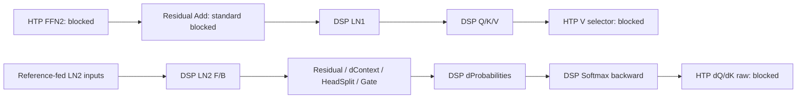

# G1 FP32 Softmax backward・LN1 projection feasibility

## 結論と認定範囲

DSP LN2からdScoresまでのbounded Backward segmentと、DSP LN1からQ/K/VまでのForward segmentを診断した。Softmaxの独立stage試験では、正しい前段値を与えても標準Multiply・ReduceSum・Subtract・最終Multiplyがそれぞれ予算を超えた。複数Custom接続版とfused Softmax版は同じdScores wordsとなり、最大double誤差2.26174586722e-5で0.002 gateを満たした。

LN1→Q/K/Vの最大誤差は2.4316564895e-6／2.77017446315e-6／5.7436790506e-6。両segmentのTap/Receiptなし最終出力も独立にaccuracy判定する。これらはreference-fed LN入力と保存Forward入力に対する診断で、実G1全体のproducer-fed correctnessではない。

FFN2→Residual断片ではFFN2 MatMulが最初のword差・最初の0.002 stage failure。Residual Addも正しいFFN2 FP32出力で独立にFAILした。Custom Addだけでは入力のFFN2誤差が残る。正しいHost FP32 FFN2＋DSP AddのcontrolはLN1 Y/dXを回復したが、DSP FFN2の実装・native実行成功を意味しない。

新しいfrontierはBackwardの標準dQ/dK raw MatMul、Forwardの標準V head selector。40-node Tap差はFFN backwardを外した35-node候補でも再現した。内部backend機構とグローバル最小再現graphは未確定。

最終9 processは同一binary/source/SDK/fixtureで数値digest一致。5382 QNN executes、47094 metricsを最終cohortだけから集計し、required metricは全PASS。標準negative controlsはFAILとして保持した。

分類:

- **FP32_SOFTMAX_PRODUCT_VERIFIED**。
- **FP32_SOFTMAX_BACKWARD_SEGMENT_VERIFIED** — 指定T32/H2 geometry、既存LN2 chainから接続。
- **FP32_LN1_QKV_SEGMENT_VERIFIED** — reference-fed XからDSP LN1がYを計算。
- **UPSTREAM_FFN2_FIRST_LOSS_LOCALIZED** — 正しい外部入力からのFFN2/Add断片内。
- **OBSERVER_FREE_PRECISION_VERIFIED** — 上記2つのCustom domainの最終出力。全G1へ拡張しない。
- **BLOCKED_ATTENTION_CONSUMER / BLOCKED_FORWARD_CONSUMER / BLOCKED_UPSTREAM_PRECISION**。
- **FP32_ARCHITECTURE_REASSESSMENT_REQUIRED / UNRESOLVED** — 全1-layer、全19層、backend内部機構、production throughput。

G1 training update、production切替、全Attention/FFN移植は0。40k→60k／200kは**NO-GO**。6031は別incidentの**UNRESOLVED / DORMANT / WATCH**を維持する。

## A. Reuse audit

開始HEADは指定base `606c55fdb65bc65666b402b1dfa0bfae424f298d`、前branchのclean tree。upstream未設定、開始時78 commitsが既知remote refsから到達不能だった。fetch/main再構築は行わず、未pushのlocal成果・前回frozen package/probe・private evidenceを正として新branchを作成した。前研究branchのHEADと保護5artifactのSHA256を保持した。

Source正本:

- [`qnn_runtime_transformer_training_generalized.inc`](../app/src/main/cpp/qnn/qnn_runtime_transformer_training_generalized.inc): G1 head別Forward/Backward、FFN2とresidual。
- [`qnn_runtime_transformer_training.inc`](../app/src/main/cpp/qnn/qnn_runtime_transformer_training.inc): 共通LN semantics。
- [`host_tests/fp32_custom`](../host_tests/fp32_custom): 既存QHPI package、native tensor、receipt、references、runner。

第二のframeworkは作成していない。既存LN Forward/Backwardのanchor-relative centering・compensated reductions・scaled RMS・range-safe denominator、ordered MatMul、HeadSplit、Broadcast、旧receipt ABIは変更しない。旧Multiplyの`a*b`をinline helperとしてpaired Productにも共有した。MatMulは既存`ordered<32,64,64,false,false>`を3 projectionへ再利用する。dContext/dWo/dProbabilitiesの数学・q順・layoutは維持する。

QHPI interface1.4と旧Op名/receipt layoutは維持。登録は21→31名。追加はpaired SoftmaxProduct、ProjectionQKV、SoftmaxReduce、SoftmaxCenter、SoftmaxBackwardのobserved/free各2名。10種類の新規数学を追加したという意味ではない。全てdiagnostic-only/default-off。production graph/Muon/optimizer/checkpoint codec/data orderは変更しない。

両headを一つのlaunchにまとめ、Q/K/Vも一つのlaunchとする。各specializationに独立counterを持つ。同じProduct specializationを最終Multiplyにも使うが、Product→Reduce→Center→Finalという依存で同時実行しない。graphExecuteは同期・逐次。将来の同一specialization concurrent graph実行には別途counter設計が必要であり、今回の証拠を転用しない。

Observed版はDSP V81 marker、入力全words、出力words、counter、time windowをINT32 receiptに書く。NoReceipt版はreceipt tensorもコピー/counter書込みも登録しない。Native FLOAT32宣言そのものを演算精度の証明にはしていない。

## B. Softmax backward

### Source-derived contract

Per-headの物理配列はrow-major `[32,32]`、H2、Dhead32。production rank2を診断ではunit leading axes付きrank4 `[1,1,32,32]`へ写像する。batch/head間の積算・混合はない。dotはlast axis=3、keep_dims=true、`[1,1,32,1]`。centeredは同じrowのdotを32 columnsへbroadcastする。

`product_h[r,c] = dProbabilities_h[r,c] * P_h[r,c]`

`dot_h[r,0] = sum(c=0..31, product_h[r,c])`

`centered_h[r,c] = dProbabilities_h[r,c] - dot_h[r,0]`

`dScores_h[r,c] = P_h[r,c] * centered_h[r,c]`

PはForwardの`Q_h K_h^T → scale(1/sqrt(32)) → causal mask Add → Softmax`の保存値。今回のPはCPU frozen Forwardからの外部FP32入力であり、HTP Forward Pの精度を認定していない。kernelはmaskの追加・再適用・renormalization・scale・clippingを行わない。masked entriesのゼロも保存Pのまま使う。

FP32 referenceはfloat積への丸め、column増加順のfloat加算、float subtraction、float final multiply。FMA contraction off、fast mathなし、DSP vectorization disabled。double analytic式を別に計算する。fused版も同じcolumn順を保つ。compensated sumへの変更は行わず、このgeometryでordered sumが既存budgetを満たすことを確認する。

対象は25既存case（24 frozen＋full upstream=1）と10非対称case。ordinary、low variance、constant、mixed signs、cancellation、小/大振幅、head別値、fixed-seed random、offsetを含む。追加Pもcausalかつheadごとに異なる。各headを別判定する。

### 正しい中間値を供給した独立stage

| Stage / 35 cases/head | 標準HTP maxAbs H0 / H1 | FAIL数 H0 / H1 | Custom maxAbs H0 / H1 | gate |
| --- | ---: | ---: | ---: | ---: |
| Product | .0567932128906 / .0435598869681 | 9 / 8 | 3.84564555134e-6 / 3.80092205887e-6 | .005 |
| ReduceSum | .127700805664 / .13069152832 | 9 / 8 | 1.52587890625e-5 / 2.05039978027e-5 | .005 |
| Centered | .372303009033 / .482849121094 | 12 / 12 | 3.0517578125e-5 / 6.103515625e-5 | .005 |
| Final Multiply | .039873638766 / .0634710120721 | 10 / 8 | 3.48472167389e-6 / 5.55042788619e-6 | .002 |

Customはobserved/freeとも全35 PASS、その実入力に対するHost ordered FP32とbitwise一致を検査する。Reduce入力は正しく丸めたFP32 product、Centered入力dotは独立double analytic sumをFP32へ丸めた値、Final入力centeredも正確な値を丸めて供給する。従って上表の標準FAILを前段Productの誤差だけへ帰属できない。

dot/centeredの.005は前研究の既存stage budgetをDevice評価前から継承し、dScores .002と別に判定する。operand conversion、accumulation、result storeの内部寄与は直接観測できず未確定。HTPがFP16演算したと断定しない。

### DSP LN2からの連続segment

`DSP LN2 F/B → Custom Residual → dContext (+dWo) → HeadSplit → Gate → dProbabilities → Softmax`

LN2が実際に生成したdXを使用し、理想Gate gradientやdProbabilitiesをHostから途中注入していない。LN2 X/dY、Residual upstream、Wo/context、saved Gate/V/Pはfrozen external FP32 inputsである。前段のLN .02、dContext/dWo .03、Gate/DP .01 gateを維持する。

| Candidate / 25 cases | dScores maxAbs H0 / H1 | 判断 |
| --- | ---: | --- |
| Custom Productのみ＋standard後段 | .0560203321422 / .0634557750209 | FAIL、Product置換だけでは不足 |
| 4 paired Custom ops | 1.40906162898e-5 / 2.26174586722e-5 | PASS |
| Fused Softmax backward | 同上 | PASS、separateと同じ最終words |
| Tap/Receiptなし、両方式 | 同上 | 自variantの出力でPASS、observed対照とword一致 |

Observed separate版はDP→Product→Reduce→Center→Finalの全consumer operand wordsとproducer output wordsを照合する。fused版はraw DP/Pおよびproduct/dot/centered/dScoresをreceiptに保存し、独立FP32式と全word比較する。±0もmemcmp/uint32で区別する。Tapなし/receiptなし内部tensorを直接観測したとは主張せず、そのvariant自身の最終dScores/dWo/parameter gradientsを比較する。

必要最小の**実証済み**Softmax FP32領域は4演算全体。検証した標準4stageは各々独立FAILした。ただし別のloweringや未知のfusionまで不可能と証明したわけではない。fusedは一つのkernel、separateは4 launches。この範囲以降の新規Custom Attention arithmeticは追加しない。

### 次のAttention boundary

Source上は`dScores K → dQueryRaw`と`dScores^T Q → dKeyRaw`、その後にscore scale、head scatter。最初の2つの標準MatMulへだけ接続した。既存raw gradient gate=.01。

| Native standard consumer | H0 maxAbs | H1 maxAbs | FAIL / 25/head |
| --- | ---: | ---: | ---: |
| dQueryRaw | .107461168893 | .0851813019781 | 5 / 5 |
| dKeyRaw | .126280396953 | .115974830262 | 5 / 5 |

保存Q/Kの最大column abs-sumは195.43645525で、測定済みdScores最大誤差からraw MatMulへの誤差伝播上界は.00442027594965。観測raw誤差.085以上をこの前段誤差だけでは説明できない。これはdScoresのgate成功と独立したblocking。scale後や全dQ/dKの統合成功を認定せず停止する。次の最小候補は既存ordered dotのNN/TN paired geometry再利用だが今回は実装しない。

## C. DSP LN1 → Q/K/V

LN1はD64/T32、epsilon=1e-5、gamma/beta各64、centeredScale=1/adaptiveScale=false。LN2と同じ数学で、既存DSP Forwardをそのまま使う。xhat `[32,64]`、inverse `[32,1]`はBackwardまで保持する。gamma/beta/weightsはexternal parameter lifetime。Q/K/Vはそれぞれ別weight `[64,64]`、`Y[32,64] * W[64,64]`、transpose_in0=false、transpose_in1=false、reduction64、出力 `[32,64]`。head splitはこのprojectionの後段で行う。

24 frozen＋20既存LN pathologicalの44ケース。correct LN1 Yを供給したstandaloneと、XからDSP LN1が計算したnative Yを分離する。大offset/low variance/constant/ordinary/random/以前の失敗fixtureを含み、Q/K/V weightsは異なる。Host arithmetic testでは非対称・cancellation等も別途検査する。

| Projection / maxAbs | Q | K | V |
| --- | ---: | ---: | ---: |
| 正しいY→standard | .00397999723276 | .00393147656278 | .00807026820321 |
| 正しいY→Custom | 2.47147319188e-6 | 2.3994641607e-6 | 5.09577405872e-6 |
| DSP LN1→Custom | 2.4316564895e-6 | 2.77017446315e-6 | 5.7436790506e-6 |

各Customは0/44 FAIL、gate=.002。標準は8/8/16ケースFAIL。Observed consumer raw Yとその実入力に対するordered FP32 dotが全word一致する。DSP LN1 Yのdouble誤差5.81823561774e-7、saved xhat6.66749372158e-7、inverse1.94379752543e-5、native saved state→Backward dX1.53640447422e-5。dGamma/dBetaも.02以内。Forward/Backward raw inputsとnative saved wordsを照合する。

LN1→Q/K/Vを最終出力とする3-node graph（saved-state Backward controlを含む）と、head selectorを付ける9-node graphを分離した。前者の4 observer条件で最終Q/K/V wordsは一致。後者はTapなしでQ/K/VをNATIVEにし、observed対照receiptとobserver-free selector最終出力を独立に測る。不可視のY/Q/K/Vの直接word観測を主張しない。

次のsource consumerはhead selector `[64,32]`との標準MatMul。selectorは各headの32連続channelsを選ぶone-hot行列で、数学的にはcopyである。Q/Kのhead出力は最大約.00195で.002 stage budget内だがFP32 wordsは一致しない。V head0/1は最大.00580941960462／.00562922005712、各8/44 FAIL。**BLOCKED_FORWARD_CONSUMER**はこのV selector。Q/Kが予算内でもAttention scoresの精度を推定しない。既存lossless HeadSplit再利用が次回の最小候補だが、3同種同時launchのcounter/ownership監査が必要。

LN1 inputはこのLaneではreference-fed。FFN2 producer誤差が修復されたという意味ではない。gate logits/Sigmoid、Attention scores/Softmax全体のCustom移植は行わない。

## D. FFN2 → Residual → LN1

同じ保護40k checkpointから前研究でfrozenした8ケースを再利用。CPU traceの前層layer17 ReLU出力A `[32,128]`、W2 `[128,64]`、Residual1 `[32,64]`を外部供給し、target layer18 LN1へ渡す限定fragment。全19層HTP Forward起点ではない。

基準はindependent double `A*W2 + residual`とordered Host FP32。前報のX誤差.00517416000366はfrozen FP32 Xとの差、今回.0051742804804はdouble式との差で、約1.2e-7のreference差を実機回帰と扱わない。

| Control / 8 cases | FFN2 maxAbs | LN1 X maxAbs / FAIL | ideal LN1 Y | ideal LN1 dX |
| --- | ---: | ---: | ---: | ---: |
| A Standard MM＋standard Add | .00379717476751 | .0051742804804 / 8 | .00209740259207 / 1 | .0240631979769 / 1 |
| B Correct Host FP32 MM＋standard Add | 7.18314831616e-7 | .00551978295697 / 8 | .00208238222159 / 1 | .0230784696406 / 1 |
| C Standard MM＋DSP Add | .00379717476751 | .00379717476751 / 8 | .00138289763701 / 0 | .0200067829808 / 1 |
| D Correct Host FP32 MM＋DSP Add | 7.18314831616e-7 | 7.18314831616e-7 / 0 | 3.00357770433e-7 / 0 | 3.42286708843e-6 / 0 |

X/FFN2/Add stage=.002、Y=.002、dX=.02。B/Dのcorrect MMはHost reference-fed controlであり、DSP FFN2 kernelは追加していない。Dは全FFN修復の認定ではない。

標準FFN2は8/8で最初のword差・最初のstage予算超過。standard Addは実FFN2入力に対する局所誤差.00367164611816で5/8 FAIL、正しいFFN2入力でも.00551986694336で8/8 FAIL。DSP Add局所誤差は1.19209289551e-7、ordered FP32 words一致、全8 PASS。CでXが失敗する理由は上流MMの誤差でありAdd不良ではない。

TapありのFFN2 outputとDSP Addのconsumer receipt、Tap XとLN1 consumer receiptを照合する。LN1は受信Xに対して全controlでY/dX局所gateを満たす（Y最大約2.29e-7、dX最大約3.97e-6）。残る理想入力との誤差はproducer lossの伝播。FFN2入力A/W2とResidualはHost FP32 bufferで、input mutation0を確認するが、標準HTP内部operand conversion等は直接見えない。

このfragmentでの最小候補はFFN2 NN FP32 MatMul＋FP32 AddをLN1まで連続させること。FFN1/ReLU、前層のResidual1のHTP producer precisionは未認定。実DSP FFN2 geometry128のnative検証を次回の限定投資とする。

## E. Observer effect

4条件はTap/Receiptの2×2。入力、数学、tensor registration/insertion順を固定し、Tap比較ではFLOAT APP_READ/NATIVEだけを変える。NoReceiptではsignature/tensor countも変わるため、backend loweringまで完全固定した実験ではない。各processは一つのcontext内で複数graphを同じ順に構築し、context identityはprivate記録に限定する。

| Source-derived graph | Tapなし / receiptあり X・dY maxAbs | Tapあり X・dY maxAbs |
| --- | --- | --- |
| 40 nodes、従来構成 | .222915754803 / 36.9745414304 | .0541295814214 / 2.79020669831 |
| 35 nodes、FFN backwardの5演算を除去 | .222915754803 / 0（外部dY） | .0541295814214 / 0（外部dY） |

35-node候補でもContext/XのTap依存が残り、同じerror値を再現する。FFN backwardと大きなdY amplificationはTap差発生の必要条件ではなかった。前回の6-node FFN backward controlでは差が消えた。今回の8-case FFN2/Add fragmentもTap有無で共有数値は同じ。これらを合わせ、再現候補をForward Attention producerを含む35-node graphへ狭めたが、単一opやbackend機構へはlocalizeしていない。

Receiptの除去だけでは共有可視tensorの差を再現しない。Tapによる変更とreceipt copy/counterの効果を分ける。Tap差が再現するgraphは必要accuracyを満たしておらず、「診断時だけ全体PASS」とは報告しない。node削除時にはloweringも変わるため、FFNの内部演算が原因でないことの普遍証明にもならない。

Cutごとのword mismatch数・maxAbs差・reference誤差を別保存する。bitwise不一致とgate FAILは別判定。memory placement、fusion、kernel selection、backend schedulingの寄与、最初に変わる内部tensor、global minimum graphは**UNRESOLVED**。限定2候補と既存negative reproducerで停止し、runtime reverse engineering/SDK変更は行わない。

## F. Coverageとarchitecture cost

L=local mathematical correctness、N=native Custom chain、P=actual bounded producer-fed、O=observer-free最終精度。これらをfull training correctnessへ読み替えない。

| Source領域 | 分類 | 証拠の範囲 |
| --- | --- | --- |
| Embedding＋position | VERIFIED_STANDARD_HTP（前研究） | 16合成caseのX予算のみ |
| LN1 Forward | VERIFIED_CUSTOM_FP32 L/N/O | 正しいX、saved stateあり。上流Pは別 |
| Q/K/V | VERIFIED_CUSTOM_FP32 L/N/O、標準BLOCKED_STANDARD_HTP | 今回44 case、LN1からnative接続 |
| Q/K head selector | VERIFIED_STANDARD_HTP（stage予算のみ） | 44 case、word精度は失う |
| V head selector | BLOCKED_STANDARD_HTP | .002 gate FAIL |
| gate projection・Sigmoid | STRUCTURAL_ONLY / INTEGRATION_UNRESOLVED | 今回移植せず |
| Attention scores・mask・Softmax・context・Wo Forward | STRUCTURAL_ONLY / INTEGRATION_UNRESOLVED | composite observer失敗、独立PASSなし |
| FFN1/ReLU | UNTESTED | 正確な外部saved operandからのfragmentのみ |
| FFN2 Forward | BLOCKED_STANDARD_HTP | 正しいA/W2でも最初の予算超過。CustomはUNTESTED |
| Residual Add before LN1 | VERIFIED_CUSTOM_FP32 L、標準BLOCKED_STANDARD_HTP | Cの局所計算も正しいがend-to-end XはFAIL |
| LN2 F/B・Residual backward | VERIFIED_CUSTOM_FP32 L/N/O | 外部X/dY/upstream条件付き |
| dContext/dWo・HeadSplit・Gate・dProbabilities | VERIFIED_CUSTOM_FP32 L/N/O | 前段gateを今回も維持 |
| Softmax product/dot/centered/dScores | VERIFIED_CUSTOM_FP32 L/N/O、標準BLOCKED_STANDARD_HTP | 正しいPはreference-fed |
| dQueryRaw/dKeyRaw | BLOCKED_STANDARD_HTP | 新しい下流frontier |
| score scale・head scatter・projection gradients | UNTESTED / INTEGRATION_UNRESOLVED | Source依存のみ |
| dValue | VERIFIED_STANDARD_HTP（前研究local .01） | 全branch接続は未認定 |
| LN1 backward | VERIFIED_CUSTOM_FP32 L/N/O（saved-state control） | 全Attention由来dYとの統合は未認定 |
| FFN backward | BLOCKED_STANDARD_HTP / INTEGRATION_UNRESOLVED | 前研究DRELU独立FAIL、今回は移植せず |
| Embedding gradient・final logits・lower-layer path | UNTESTED | 全1-layer/19-layerは未認定 |
| Gradient materialization・8-MB accumulation | 前研究VERIFIED_CUSTOM_FP32 / VERIFIED_STANDARD_HTPを継承 | 全registry integrationは未完 |

### 計算量・memory

| 追加数学 / layer / microbatch | Exact work | Unique FP32 payload | Scratch/ownership |
| --- | ---: | ---: | --- |
| 3 Q/K/V NN dots | 393216 MAC = 786432 mul/add FLOP | Y＋weights＋outputs81920B | dynamic scratch0、Y共有、saved hat/inverse別 |
| Softmax Product | 2048 mul | 24576B | H2 paired、同shape |
| ReduceSum | 2048 FP additions（zero初期値を含む） | 8448B | rows64、各32 columns |
| Centered | 2048 subtract | 16640B | 64 row scalarsをbroadcast |
| Final Multiply | 2048 mul | 24576B | Product数学を再利用 |
| Fused Softmax | 上記と同じ8192 scalar ops | 24576B unique compulsory input/output | product[32]128Bのsource stack上限、frame/runtime別 |

数学的なreduce非自明和は1984 additions（32−1 ×64 rows）なので、zero初期addを除くFLOP表現なら総8128。どちらの数え方かを明示し、MAC=2 FLOPとの混同を避ける。

Separate Softmaxはproduct8192B＋dot256B＋centered8192B、計16640Bの中間tensorを持つ。fused free版はそれらのnative payloadと3 launchesを削減する。observed版は中間をreceiptに残すため同じmemory savingsにはならない。receipt量はseparate74368B、fused41248B、QKV81952B。Logical payloadとphysical DDR/VTCM allocationは別で、allocator reuse/runtime workspace/Host snapshot guardsは未測定。

既存dContext/dWo/dProbと今回QKVを合わせた数学は720896 MAC/layer/MB、19層13697024、8MBで109576192 MAC。候補FFN2 NN geometryは262144 MAC/layer/MB（QKV1本の2倍のwork）、unique A/weight/output57344Bで、kernel時間は未測定。

3 QKV dotsのnaive scalar load/store volumeは3170304B/layer/MB（cache reuse無視）。Softmaxはseparateの最低stage read/write約74240B、fused unique compulsory24576Bだが実sourceの2-pass operand rereadでは約40960B。DDR traffic実測ではない。saved P8192BはForwardからBackwardまで必要。LN saved xhat/inverse8320Bもprojection後に解放できない。

| Candidate | nodes / tensors / logical B | 3 processのnative execute median |
| --- | ---: | ---: |
| LN2→dScores、separate observed | 12 / 53 / 462672 | 12.721–13.009ms |
| 同、observer-free | 12 / 41 / 190092 | 11.930–12.042ms |
| LN2→dScores、fused observed | 9 / 44 / 412912 | 12.814–12.933ms |
| 同、observer-free | 9 / 35 / 173452 | 11.787–11.926ms |
| QKV standalone observed | 1 / 8 / 163872 | 14.870–14.939ms |
| QKV standalone free | 1 / 7 / 81920 | 15.220–15.643ms |
| LN1→QKV＋saved Backward observed | 3 / 20 / 239848 | 15.493–15.732ms |
| 同、observer-free | 3 / 17 / 115844 | 15.347–15.514ms |
| 同＋native standard selectors、observed | 9 / 28 / 280808 | accuracy control、速度認定なし |
| 同＋native standard selectors、free | 9 / 25 / 156804 | accuracy control、速度認定なし |

Separate/fusedのnative FP tensorsは18/12、logical native FP payloadは82304/65664B。LN1 chainは3 native tensors、16512B。Host run内の入力＋immutable snapshot＋最終output/guardだけの最低payloadはfused free157856B、LN1 free165568B。metadata、fixtures、double references、decode copies、backend buffersを含むHost peak memoryは未測定。

Paired Productの全case math median29us/full168us、Reduce22us/full60–61us、Center24us/full124us。最終Multiply単独steady math25–28us/full171.5–175us。fused observed steady windowはmath欄146–150us/full297.5–302usだが、前者にも中間receipt storeが入る。QKV3本のordered scalar mathはstandalone11.201–11.219ms、native11.286–11.296ms、receipt込みwindowは約11.70–11.82ms。MatMulがこのpayloadの主要演算costである証拠はあるが、全trainingの時間支配率ではない。

fused native-freeのseparateとの差は各processで約13–143us。observedでは速い/遅いが混在し、Tapあり/freeのwallも別の約15.5–15.7msになる。launch数・receipt量の減少から普遍的speedupを推定しない。小規模scheduling/Host/graph条件の差は未分離。

graphFinalize medianはSoftmax各process51.955–54.393ms（全range22.290–99.126ms）、QKV55.941–57.358ms（21.098–71.351ms）、Producer/Cuts65.598–71.351ms（26.417–122.541ms）。異なるnode数のgraph群medianでありproduction finalize予測ではない。Observer40-nodeのlogical BはBOOL_8を1Bで数えるOneGraph集計を用いる（593536B）。補助segmentgraph表示のBOOL一律4B集計は採用しない。35-node候補は65 tensors/523904B。

19層へ仮置きしたfused Backward domainは171 nodes/665 tensors/3295588 logical B（free）、separate228 nodes/779 tensors/3611748B。LN1＋QKV＋saved Backward診断は57 nodes/323 tensors/2201036B（free）。これはgraph所有物の単純和であり、共通parameter・liveness alias・MB scheduling・未検証領域を含むproduction設計ではない。

過去のdProb約1.99ms、同chain約11.2–11.4ms、LN1 receipt window約455usは異なるinstrumentationの参考値。本cohortでLN1単独windowはemitしていないため差分kernel costの算出に使用しない。今回のwallを19/38/304/608倍してthroughputとは呼ばない。

測定は非exclusive BACKGROUND_CORRECTNESS。fixture0、9反復、先頭をwarmupとして除外し8のmedianを各processで計算する。NoReceiptのtimer0は未観測sentinel。fused observed math windowには中間receipt storeも含むため純数学時間と呼ばない。QNN execute wallはHost API/log overheadを含む。graph finalization、全case kernel windows、steady wall、純算術推定を分ける。

19層のQKV追加算術は7471104 MAC/MB、8 MBで59768832 MAC。Softmaxは155648 zero初期add込みscalar ops/MB（8MBで1245184、非自明addだけなら154432/1235456）という算術集計であり、8MB scheduling時間の予測ではない。QKVのweights933888B/19 layers、outputs466944B、Y155648B。8MB同時activation保持ならY＋QKVは4980736B、weightsは共用。LN1 saved stateは158080B/19、8同時なら1264640B。実際の逐次MBでは8倍同時保持は必須でない。

fused Softmax中間削減16640Bは19層316160B、8同時2529280B。全19層のFP32 domainを実装したわけではなく、dWo等の既存memoryとのalias/reuseやoptimizer storageを含む総training memory予測でもない。

比較可能なnode-equivalent集合では、前研究44/146にQKV3とSoftmax8を加えて55/146（約38%）。LN1 backward local13を含め68/146（約47%）。追加Forward Add局所control等はこの固定比較集合に足していない。これはFLOP比率・時間比率・correctness率ではない。既存G1 estimator56F＋90B=146/layer、L19全graphは2783 nodes（Adam除外）。

数学sourceは既存ordered dot共有＋paired geometry＋row reduction/subtraction。実装量はsegment_ops.h: 38 lines / 3350B、softmax_ops.h: 29 lines / 3672B、softmax_projection_probe.h: 40 lines / 19766B、segment_kernel_test.cpp: 20 lines / 3999B、softmax_kernel_test.cpp: 10 lines / 3651B。compactな長い行を含むのでLOCだけで保守費用を評価しない。reference、negative control、receipt layout、native lifetime、context teardown、allowlist exporterと3-process cohortが追加の維持単位となる。

### 方式比較と投資判断

| 方式 | 正当性・費用・判断 |
| --- | --- |
| A Individual Ops | 独立stageの必要性判断と旧kernel再利用には有効。Softmax4 launches、native中間、ABI/receipt増加が残る。production設計として個別Op追加だけを続ける方針は推奨しない。 |
| B Fused FP32 segments | 次の主投資先として推奨。今回Softmax fused/separateの同値性、LN1→QKVのnative/observer-free契約が成立。所有権・saved-state・referenceをsegment単位で固定する。速度は実測条件付きで判断する。 |
| C Wider DSP FP32 backend | 今回は評価のみ。全1-layer、Forward P、FFN全体、gradient registry、optimizer連結、production scheduleの証拠が不足し、全面置換を正当化しない。 |

まとめる候補はdProbabilities＋Softmax（DP8192B materializationと1 launch削減可能性）、FFN2＋Residual（8192B中間削減候補）、LN1＋QKV（Y8192B削減候補）。LN1 Yにはgate projectionも依存するためfusionで消せるとは限らず、saved xhat/inverseは残る。今回はこれらの追加fusionを実装しない。

実測scalar MatMulがelementwise/reductionより大きいcost候補。HVX output-column parallelizationはq順を保持できる可能性があり、QKV393216 scalar MACを理想上12288の32-lane stepsへ対応できるが32倍speedup予測ではない。Blocking/weight transpose再利用でload reuseを改善できる。q方向のparallel reduction/FMA化は数値契約を変えるので新しいaccuracy試験が必要。HVX resource指定はvector arithmetic実行の証明ではない。最適化は今回行わない。

subnormal/overflowの全IEEE領域での同一性は未認定。Host negative testsは非有限入力/overflowを拒否するが、今回のdevice workloadは有限なfixed-fixture dynamic range内。fast mathなしというcompile設定だけからFTZ behaviorを断定しない。

## G. 最終判断

1. **Custom ProductはPASS**。独立35ケース/headで.005とFP32 wordsを満たす。
2. **標準ReduceSumはFAIL**。正しいFP32 productでも最大.1306915、.005超過。
3. **必要最小の実証領域はSoftmax backward4演算**。各標準stageが独立FAIL、separate/fusedどちらでも回復。
4. **dScoresはobserver-freeでPASS**。LN2からの実DSP gradientを使用。ただしLN2 X/dY/P等はexternal正確入力。
5. **DSP LN1→Custom Q/K/VはPASS**。各.002以内、saved stateを保持。
6. **次のForward blockerはV head selector**。数学的copyでも標準MatMulで精度が失われる。
7. **FFN2が最初の予算超過**。Residual Addも正しいFFN2 outputで独立FAIL。LN1 kernelの再修正は不要。
8. **Tap差は35-node候補へ限定**。FFN backwardを外しても残る。機構/最小graphは未確定。
9. **Surgical方式は診断に継続使用**。productionの中心設計はsegment単位へ移すべき。
10. **Larger segmentはSoftmaxを優先**。次にdProbabilities境界、FFN2＋Residual、LN1＋projection/selectionのownershipを設計する。未検証数学をまとめて実装しない。
11. **次回の最小実機検証**は、(a) V selectorを既存lossless HeadSplitへ置換する限定control、(b) NN/TN dQ/dK raw geometry、(c) F128→64 FFN2 ordered dot＋既存Add。各Lane独立、上流producer精度とlocal精度を分離する。全Attention/FFN移植へ自動拡張しない。
12. **40k→60k／200kはNO-GO**。Full training correctness、全1-layer Forward/Backward、Forward P、FFN、全gradient materialization、全19層の最小domainは未成立。

## H. Provenance・検証

- Branch: `investigation/g1-fp32-softmax-ln1-projection`。
- Working tree: closeoutでcleanを確認。生成binary/private evidenceはignoredなbuild領域に保持する。
- Base: `606c55fdb65bc65666b402b1dfa0bfae424f298d`。
- Device-tested source/probe: `5eb5b6bf73e56c33732590e086bcd7b6be72dbb6`。Packageは`61f77bc029de9ea5a8a1426791b6c0203cf178c2`のbytesを再利用。ProbeOnlyでpackage source・compiler・SDK・binary hashesを照合した。
- Final HEAD: このreportを含む最終commit。`git log -1 --format=%H -- docs/g1-fp32-softmax-ln1-projection-feasibility.md`で取得でき、exact hashはprivate closeoutと完了回答にも記録する。
- DSP package SHA256: `fcee5c0052274e7ae5cfaef093542099b84d5d62c57aed41ac18368cc1f16fb1`。
- Host package: `8f24436ec74b678f214d84391cf819fb3c98fd6e51926e90b407081fc8f20876`。
- Probe: `0b714bae344cd9aba1e7e6879a9971d53846a9fa7d3087d4da7127115eea1c6b`。
- QAIRT `2.48.40.260702151143`、API `2.37.0`、V81、Hex SDK `6.6.0.0`、tools `19.0.07`、NDK `26.2.11394342`。
- Hex compiler SHA256 `039c2fc1840b06a3601fa63972d86d1b575d7a1afeae2f3504a1843df147c047`、NDK compiler `ce4566f8c00c9d36d2724bd4af6a2714d8daed1c09f2290d7c4751a766fbb7b3`。
- Frozen one-layer fixture `388f4d8b30b86997d2f03f732e5a3210f7e2b3015af883579e3f0659df9d9f4f`。
- LN1 parameters `7102ec13544df457922942e3282b15a8612da91c51156692000fc0dd0a21f97f`。
- Producer fixture `ee9e3185b9a5857d874b5791a1e4b34c153401367dc208a1b74fa3bafa1a9580`。

| 最終cohort、各3 process | executes/process | metrics/process | canonical numerical SHA256 |
| --- | ---: | ---: | --- |
| oneSoftmax | 992 | 10265 | 52d5fa6195f408e7e59811b3e84d46ec39ca7bfa5135ea27d5c3aacc3d8db7ed |
| oneProjection | 538 | 3960 | 6fee54dacfffee473baa7e5fac2fc6f1a4dd8d6313189c6a253a9aa7473dbc01 |
| oneProducer | 264 | 1473 | b90322b9ea2426dc64ebb7a757cd61637e68ea1faa2f7db66b97f8c97064fc18 |

Digestは順序付きonemetric/cutDifference/productObserver行から作り、timers/countersを除外する。各laneの3 recordsはcounts・全metric groups・digestが一致。graph configuration間の同値性は別途比較した。API0、teardown、required finite、input mutation0、poison/canary、観測版receipt markers/全wordsを検査。NoReceipt版にreceiptがあるとは報告しない。

Pilotと最終cohortを分離した。最初のpilotは標準後段のTap不変性を仮定したassertで停止したため除外。±0を区別しないvector float equalityをmemcmp/uint32へ強化する前の2 processも別保存し、source clean gateで次のprocess開始前に停止した。最終結果は修正版の同一binary・同じsource・同じconfigurationの3独立processだけを使う。

Validation: **Fast PASS**（最終92.9s）、**Host PASS**（527.5s）、**Qnn PASS**（582.5s、pinned SDK/core/API/build/APK audit）、**Device smoke PASS**（100.2s）、**Muon W8 114/114 PASS**（maxAbs1.490116119e-8、worst relative L2 4.40269854e-8、cosine1、RPC success、finite、fallback=false）。Qnnのoptional inventory不足はadvisoryであり、required SDK欠落やfallbackではない。

追加Host gate: Softmax210 cases（double dScores worst8.52793813522e-6、全FP32 words・fused中間・NoReceipt・guards PASS）、new geometry136 arithmetic stress calls、既存MatMul136＋LN chain68、Broadcast35、dProbabilities70、observer168 pairs、shape2948 checks PASS。136 stress callsはFP32 arithmetic identity試験で、任意の大きなY/weightを使う一部にdouble誤差.0322703がある。このstressをLN1 projection .002 gateの合格へ転用せず、accuracy認定は別のLN1-derived44ケースで行った。

公開exporter self-testはpositive allowlistと15破損条件拒否を検査。Python optimized modeでも同じ検査が有効。最終cohort9 recordsから3 laneのdigest/count/required accuracy/source/compiler/package/probe/SDK/fixture一致を確認した。floatのbit mismatch、reference accuracy、標準負例のFAILを別のfieldsで保持する。

最終cohortのbattery temperatureは35.0–36.0℃、Android thermal statusは全て0、USB powered=false。background/nonexclusive条件で、他app activityやscheduler/clockを固定したproduction benchmarkではない。raw battery/thermal状態とdevice identityはprivateに保持する。

実行前に物理端末同一性、Awake、top-resumed、active run不在、Host20GiB/device12GiB、thermal/battery、APK audit、Skel/runtime/package/probeのhash、保護artifactを確認する。各runはBACKGROUND_CORRECTNESSでfocus takeover0。無断wake、force-stop、SDK/firmware/system変更はない。

保護40k SHA256 `89f197d3085f496a22a9ab4ef2161bf2644ba9311b4571faed55f60a7959243d`と、tokenizer/cache/manifest/run-planの5SHA256を照合。200kはUNSTABLEのまま。100k baseline、41,647/42k forensic evidence、既存private research branchesは変更しない。Push/PR/merge/history rewrite/training updateは0。

Public aggregateはallowlist exporterで数値group・hash・digest・countだけを抽出する。raw tensor/checkpoint/corpus/device識別子/private ledger/logcat/SDK binary/APK hash/絶対local pathはcommitしない。[`g1-fp32-softmax-ln1-projection-summary.json`](results/g1-fp32-softmax-ln1-projection-summary.json)、[`export_public_softmax_projection.ps1`](../scripts/export_public_softmax_projection.ps1)。
