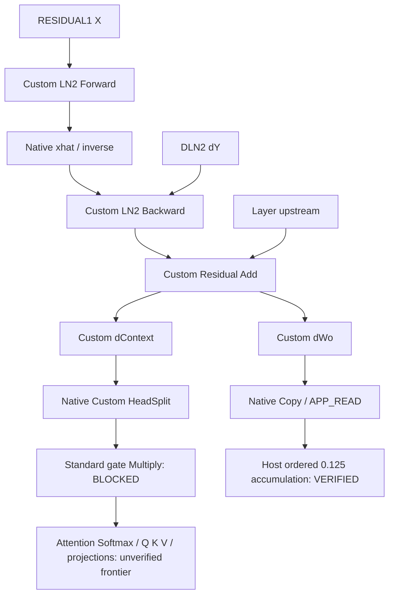

# G1 one-layer FP32 backward precision frontier

## Preregistration

Base `665a88256d8afb806bc1d222802691b2c3a0e904`, clean tree, no upstream.
Branch `investigation/g1-one-layer-fp32-backward`. Local unpushed research is
authoritative. Previous numerical source45b4cee and exact frozen package/probe,
all old refs/evidence/checkpoints remain preserved.

Production source audit: generalized training builder, shared LN builder,
generalized execute materialization, training runner accumulation, parameter
metadata, CPU generalized trace. Actual G1 is T32/D64/F128/H2/head32 with
HEADWISE_G1_SIGMOID, scale1, causal additive mask -10000 and epsilon1e-5.
Both head selector/scatter MatMuls and sigmoid-gate forward/backward are included.
No one-head simplification and no production builder replacement.

Fixtures are frozen before device results:16 coherent synthetic single-layer
forward states (eight gradient recipes, ordinary and stressed Wo/Wv ranges),
8 read-only40k checkpoint parameter layer18 states. Artificial token rows and
external upstream gradients are used; no private corpus, training batch replay,
final test or checkpoint update. Recipes: normal, large8, small1e-4, cancellation,
mixed magnitude, repeated tokens/patterns, seeded random, zero. Each batch group
has eight distinct inputs. Full external upstream is retained without shrink.
CPU generalized forward supplies saved inputs; analytic double and independent
sequential FP32 references provide per-stage comparisons. Checkpoint-derived
saved state is CPU-produced, not evidence for a full19-layer HTP forward.
Frozen fixture SHA256:
`388f4d8b30b86997d2f03f732e5a3210f7e2b3015af883579e3f0659df9d9f4f`.

| Tensor / contract | Frozen absolute gate | Basis |
| --- | ---: | --- |
| LN Y/xhat/inverse | 0.002 | existing ordinary forward gate |
| LN dX/dGamma/dBeta, residual | 0.02 | existing LN gradient gate |
| dContext/dWo, projection dW, aggregate dWo | 0.03 | existing generalized parameter/MatMul diagnostic |
| Head selector | bit-exact local input words; abs0.002 global | selector must copy one feature without arithmetic; ordinary precision budget |
| Head gated dContext, dProbabilities, dV, dQ/dK | 0.01 | tighter than general gradient0.03; reserves error budget for projection/merge |
| Softmax product/dot/centered | 0.005 | bounded probability-weighted reduction; centered error passes through probability |
| Softmax score gradient | 0.002 | row Softmax Jacobian infinity norm <=0.5; reserves downstream dot budget |
| Gate product/dot/dlogits | 0.01 | same activation-gradient budget |
| dLN1 contribution | 0.02 | consumer LN input-gradient budget; LN1 itself remains gated by frontier |
| HTP upstream X/dY/context | 0.002/0.01/0.002 | ordinary activation / gradient producer controls |

These are bounded diagnostic absolute budgets, not guarantees for arbitrary
coefficient norms. Host references must meet them before device trials.
Record maxAbs, RMS, relativeL2, maxrelative(floor0.001), nonfinite, output words,
local(actual-input) versus global propagation error, and FP16 counterfactuals.
FP16 model agreement does not reveal actual internal dtype or accumulation.

Native/tap/fused LN2 and standalone/integrated outputs are compared on the same
fixtures/runtime. Only after a blocking operation is observed may one new Custom
operation type be added to refute it. Further blockers stop DSP expansion.
Accuracy-failing full Attention is not performance-promoted.

Host materialization uses the existing registry (layer18.wo, MUON,64x64) in shadow
storage. The exact production expression is copied: destination[j] += source[j]
*0.125f, microbatch0..7. Compare with independent FP32 ordered accumulation and
double analytic average, check every registry entry and immutable model state.
No optimizer function is called; training updates0.

Three independent final processes, identical binary/fixture/SDK; QNN API, finite,
kernel receipts, full writes, canaries, mutation, and observer effect are separate
gates. Pinned QAIRT2.48.40.260702151143/QNN2.37.0/V81, Hexagon6.6.0/tools19.0.07,
NDK26.2.11394342. No fast-math/FMA change/vectorization.

Initial readiness was BLOCKED_DEVICE:Dozing/top unknown. No device numerical run
was started. User reported manual readiness; guards must be rechecked immediately
before runs. Host20GiB/Device12GiB and protected40k SHA256
89f197d3085f496a22a9ab4ef2161bf2644ba9311b4571faed55f60a7959243d remain required.
UNSTABLE guard remains set.6031 remains UNRESOLVED / DORMANT / WATCH.

No practical performance ceiling is defined: no BLOCKED_PERFORMANCE by impression.
Record setup, first/steady, kernel elapsed windows, copies, validation, logical
traffic/RSS and device conditions; runtime VTCM/DDR/power may remain unresolved.
Do not extrapolate micrograph wall to full-model throughput.
40k→60k /200k NO-GO. No all19-layer integration, production optimizer/backend,
checkpoint/data-order/SDK change, push, PR, merge or history rewrite.

## Bounded change after exploratory Device results

Source4e78f62 exploratory graph: all24 standalone and integrated-native LN2
segment gates passed, but integrated Attention had19 final-gradient gate failures.
At tap case0, dWq words differed from native (observer effect); further full
Attention execution stopped. No full Attention success is claimed.
The selector changed values: case0 dContext differs from its independent FP32
reference by <=2.53319740295e-7, while h0-selected differs by6.56604766846e-4.
By the triangle inequality this cannot be a bit-exact selection of actual dContext.
The predeclared selector copy contract is therefore blocked before gate multiply.

One new type, HeadSplit, copies the two T32/head32 columns with FP32 memcpy,
FLOAT32/flat4/direct/DDR_ONLY, receipt of2048 input plus both1024 output words.
No reductions, transpose arithmetic, broadcast expansion or HVX implementation.
The final independent control uses actual DSP dContext, standard selector
direct/Copy-native/tap/native-output-Copy variants. Only a reproduced selector
blocker permits HeadSplit → standard broadcast gate Multiply. Any next failure
stops Custom expansion. The old full Attention observer mismatch remains unresolved.

An independent HTP-produced LN2 segment includes CPU-fed LN1 output → Q/K/V
projection → head selectors → QKᵀ scale/mask/Softmax → contexts → sigmoid gates,
scatter/sum → Wo projection + input residual → Custom LN2. Its dY is produced
from external upstream, W2ᵀ, FF1 ReLU mask, W1ᵀ. LN1/embedding and language-loss
producers are omitted. Upstream projection q/k/v have ordinary forward0.002 gates
fixed before that lane's first device result. Compare X/dY/context to CPU generalized
saved state separately, then compare Custom LN2/MatMul to double using the actual
received X/dY/context. A failing upstream is not a LayerNorm kernel failure.

## Results (2026-10-14 JST)

**ONE_LAYER_LN2_SEGMENT_VERIFIED** (bounded one-layer dependency fragment,
reference-fed saved inputs), **GRADIENT_ACCUMULATION_VERIFIED**,
**BLOCKED_ATTENTION_BACKWARD_PRECISION**, **BLOCKED_UPSTREAM_PRECISION**.
The direct DSP LN2 → Native dContext → Custom HeadSplit connection is verified.
No safe return to standard HTP arithmetic is established at the next broadcast
gate Multiply. **ONE_LAYER_BACKWARD_VERIFIED is not assigned.**
The prior DSP LayerNorm and LN2/MatMul verification remains valid independently.

### A. Actual G1 dependency map

Source: `qnn_runtime_transformer_training_generalized.inc` forward emission and
backward emission, `qnn_runtime_transformer_training_generalized_execute.inc`
APP_READ materialization, `qnn_transformer_training.cpp` microbatch aggregation,
`transformer_parameter_metadata.h` and `tiny_language_model_cpu.cpp`.
Production code is unchanged. The reusable production builder is a monolithic
full-model runtime method; there is no Custom-op injection hook. The diagnostic
reuses the CPU generalized forward trace, parameter registry, QNN/QHPI package,
references and guarded runner, and mirrors only the required node definitions.
Host execution of the actual diagnostic builder through the existing shape
validator checks transpose, broadcast, reduction axes and inferred output shapes.

| Tensor / operation | Shape, physical row-major | Domain / direction | Consumer / next boundary | Reference / gate |
| --- | --- | --- | --- | --- |
| LN1 normalized input N | T32×D64 | external FP32 APP_WRITE here; production HTP native | Q=N Wq, K=N Wk, V=N Wv, sigmoid(N Wg) | CPU trace; projections0.002 |
| Q/K/V head select | T32×head32, selector64×32 | standard HTP MatMul/native | Qh Khᵀ / Vh | analytic equations; forward0.002 |
| Scores / masked scores | T32×T32 | HTP native, scale1/sqrt32, mask-10000 | Softmax over token-column axis | stable analytic Softmax |
| Ph / Ah / Gh | 32×32 /32×32 /32×1 | HTP native | Ah=Ph Vh; Ah Gh; scatter with selectorᵀ | CPU trace; producer controls |
| AttentionContext | 32×64 | reference-fed APP_WRITE or HTP native | context Wo; dWo |0.002 producer gate |
| RESIDUAL1=X | 32×64 | input+AttentionContext Wo, HTP native or external | Custom LN2 Forward |0.002 producer; local LN reference |
| LN2 saved xhat/inverse |32×64 /32×1 | Custom FLOAT32/native; optional APP_READ | same-graph Custom backward | Y/xhat/inverse0.002 |
| DLN2=dY |32×64 | DFF1 W1ᵀ, external or HTP native | Custom LN2 backward |0.01 producer gate |
| DRESIDUAL1_LN=dX |32×64 | Custom FLOAT32/native | Add with external layer-output upstream |0.02 |
| DRESIDUAL1 |32×64 | Custom Add/native | dContext /dWo |0.02 |
| DCONTEXT |32×64 | Custom: DRESIDUAL1 Woᵀ/native | selector64×32 → gated head dContext |0.03; selector copy contract |
| dWo |64×64 | Custom: AttentionContextᵀ DRESIDUAL1 | Native Copy→APP_READ→Host registry |0.03; full4096 words |
| dGatedContext_h |32×32 | standard selector or new Custom HeadSplit/native | multiply Gh; dGate product Ah | copy words;0.002 global |
| dContext_h |32×32 | standard broadcast Multiply | dPh=dContext_h Vhᵀ; dVh=Phᵀ dContext_h |0.01; blocked |
| dPh /Softmax product/dot |32×32 /32×32 /32×1 | HTP MatMul/Multiply/ReduceSum | dPh -row dot |0.01 /0.005 |
| dScores_h |32×32 | Ph*(dPh-dot), HTP native | dQraw=dScores Kh; dKraw=dScoresᵀ Qh |0.002 |
| dQh /dKh /dVh |32×32 | HTP, q/k scale1/sqrt32 | scatter32×64 and sum two heads |0.01 |
| dGate |32×1 per head →32×2 | selected dContext*Ah, ReduceSum, scatter/sum | G*(1-G), gate dlogits |0.01 |
| dWq/dWk/dWv/dWg |64×64 /64×2 | Nᵀ dQ/dK/dV/dGateLogits, APP_READ | MUON /AUX_ADAM registry |0.03; exploratory failures |
| DLN1 |32×64 | dQ Wqᵀ+dK Wkᵀ+dV Wvᵀ+gate contribution | LN1 backward |0.02; not reached with verified inputs |
| DINPUT_NORM →DINPUT |32×64 | LN1 backward then +DRESIDUAL1 | next lower layer or embedding gradient | UNRESOLVED |

Production declares these as rank2 tensors. Diagnostic Custom contracts use
`[1,1,T,D]` /`[1,1,T,head]`, with identical row/feature memory order and unit batch
dimensions; the last reduction/Softmax axis is3 instead of production axis1.
This is semantic shape parity, not byte-identical graph identity. Mathematical
transpose flags change indexing, not physical layout: dContext M32/N64/K64,
A not transposed/B transposed; dWo M64/N64/K32, A transposed/B not transposed.
Each performs131,072 MAC. All external/tapped floats are FLOAT32; standard HTP
internal arithmetic precision remains unspecified.

### B. One-layer integration and producer controls

24 fixtures: synthetic ordinary0..7, synthetic stressed8..15, checkpoint-derived
16..23. Each eight-case group has distinct inputs, including a zero-upstream
control. The40k checkpoint is decoded with the existing codec and exact config,
seed1 and step40000 guards; only parameters are extracted. The final layer18
CPU generalized forward trace uses artificial token sequences. No corpus replay,
final test, original checkpoint write or optimizer update occurs.

The reference-fed fragment takes X/dY/context/gates saved by that CPU forward and
an explicit FFN gradient recipe. DSP Forward computes saved state and DSP Backward
consumes it in the same graph. Neither Host dX nor DRESIDUAL1 is injected.
References start at external X and use double analytic LN and double dot products.
Independent FP32 references use ordered separate product/sum operations.
The standalone fragment, native materialization, tap/fused and direct Native
HeadSplit integration have identical dContext/dWo words for every case.

| Final output | MaxAbs double,24 cases | Gate | Failures /process |
| --- | ---: | ---: | ---: |
| LN Y /xhat |7.30727450549e-7 |0.002 |0/24 each |
| inverse |1.31226658873e-6 |0.002 |0/24 |
| LN dX |3.37811693463e-6 |0.02 |0/24 |
| dGamma |3.24221166323e-5 |0.02 |0/24 |
| dBeta |7.89668411016e-6 |0.02 |0/24 |
| DRESIDUAL1 |3.7610555772e-6 |0.02 |0/24 |
| dContext |2.47924264372e-5 |0.03 |0/24 |
| dWo |3.11343890047e-5 |0.03 |0/24 |

Three processes agree exactly. The head-integrated graph has8 nodes/33 tensors:
Forward, Backward, Add, both MatMuls, HeadSplit and two gate Multiplys.
Forward receipt→Backward saved inputs, Backward dX→Add, Add→both MatMuls,
MatMul dContext output→HeadSplit input and both HeadSplit output words are checked
in full. The tap and native head/gated outputs agree bitwise. Integer receipts
are present throughout: observer-free production lowering is not established.

The40-node HTP-produced segment begins at CPU-fed LN1 normalized values and layer
input, executes both Q/K/V head branches, mask/Softmax/gates/context merge/project
and residual, then the real Custom LN2. It computes FF1/ReLU mask and dY with
standard HTP FFN backward MatMuls. Input embedding/position, LN1 producer,
language loss, dW1/dW2 and the rest of the19-layer graph are omitted.

| HTP producer visible output | MaxAbs | Gate | Failures /24 |
| --- | ---: | ---: | ---: |
| Q projection |0.00397996334314 |0.002 |8 |
| K projection |0.00393121185761 |0.002 |8 |
| V projection |0.00807023329637 |0.002 |16 |
| AttentionContext |0.0120248794556 |0.002 |8 |
| X reaching LN2 |0.0541305541992 |0.002 |16 |
| dY reaching LN2 |2.79020667076 |0.01 |10 |

The earliest tested forward tier is the standard Q/K/V projection, before DSP LN2.
Projection references use double and independent FP32 dots of the actual external
LN1 values/weights. X/dY/context producer comparisons use frozen CPU generalized
FP32 saved state; this is not a fully double, end-to-end19-layer forward oracle.
It already establishes material information loss before DSP. Recomputing double
LN/MatMul from the actual received X/dY/context gives zero Custom failures:
max dContext2.16549353382e-5, dWo2.85519150225e-5. These local passes do not
restore the correct ideal upstream values. Real-checkpoint HTP producer accuracy
and full backward remain blocked/unresolved, rather than LayerNorm failures.

### C. Attention precision frontier

The standard selector is tested direct, Copy→native, Copy with float tap, and
standard-native-output→Custom Copy receipt. All four results agree bitwise.
The Copy operand/output words are exact. Each selector must preserve all1024
selected words, independently of its supplementary absolute0.002 gate.

| Boundary | MaxAbs, actual DSP-input local reference | Absolute failures /24 | Word contract |
| --- | ---: | ---: | --- |
| standard head0 selector |0.0239562988281 |11 |FAIL on21 nonzero cases |
| standard head1 selector |0.0293807983398 |13 |FAIL on21 nonzero cases |
| Custom HeadSplit |0 |0 |all words exact, native/tap |
| next standard gate Multiply, head0 |0.0205315328051 |2 |local absolute FAIL |
| next standard gate Multiply, head1 |0.021057617723 |2 |local absolute FAIL |

The end-to-end connected gate maxima are0.020530723808 /0.0210617903796,
compared with the X-origin double reference. Both exceed0.01; the Custom portion
still passes. HeadSplit alone is insufficient. Additional Custom expansion stops
here, as preregistered. The next candidate is FLOAT32 broadcast Multiply for
`[T,head] * [T,1]`, optionally a future fused split+gate candidate with separate
identity. Existing diagnostic Multiply requires equal element counts and cannot
be silently treated as the G1 broadcast kernel.

The standard selector matches the FP16-equivalent output-rounding counterfactual
exactly (model maxAbs0). Selector one-hot arithmetic cannot distinguish input
rounding from output rounding or internal accumulation. The gate's output-only
half counterfactual differs by up to0.03125: that model alone is insufficient.
The actual load precision/rounding locations remain UNRESOLVED.

Three distinct frontiers: first value loss is selector; first copy-contract failure
is also selector even for ordinary cases within0.002; first absolute failure
depends on fixture/head, with11/13 selector cases failing. Error amplification into
later parameter/input gradients is separately demonstrated only in the exploratory
full graph, not certified for the final Custom extension.

The exploratory59-node current-G1 backward fragment includes the complete two-head
gate/Attention path through dWq/dWk/dWv/dWg and DLN1 contribution. Its native24-case
run had19 final-gradient failures; stressed case9 had dWq0.159574, dWk0.236886,
dWv0.0691502, dWg0.433618 and DLN1 contribution0.145151. Tap case0 changed dWq
words and execution stopped. That lowering observer effect remains unresolved.
Those are one-process/source4e78f62 exploratory observations, not three-process
final-cohort claims. Double/FP32 equations and Host finite differences exist for
all stages; reliable full Attention device certification was not obtained.
That early-stop process exited139 and stderr recorded a segmentation fault after
the observer marker; its path returns before explicit QNN teardown. Teardown
failure cause is not established. It is retained as a failed diagnostic process,
not counted as a successful numerical/ownership process. Final source4763446's
bounded cohort exits0 with successful context/device/backend frees in all3 runs.

LN1 backward, its residual and the next lower-layer gradient were consequently
not promoted or implemented. Further work must preserve gate derivatives, head
scatter/merge, softmax product/reduction/subtract, Q/K/V and projection paths.
A safe return after gate or a later Attention operation is not yet proven.

### D. dWo materialization and eight-microbatch accumulation

Custom dWo FLOAT32 native output passes through Custom Copy to APP_READ; its
producer/output and consumer/input receipts compare all4096 words. Direct tapped
dWo and native-materialized dWo are bitwise equal. Poison overwrite, canaries,
input immutability, finite values and separate QNN status all pass.

The existing registry is used on shadow storage with full G1 identity:
`layer_018.wo`, MUON, `[64,64]`, registry index204, flattened element offset674688
(byte offset2698752), input-feature rows/output-feature columns. Names, roles,
shapes and no-alias ownership are checked across all entries. The production
materialization's vector-assignment/registry semantics are reproduced in the
standalone diagnostic; the actual production execute function is unchanged.

Each microbatch supplies its own actual DSP dWo. The existing expression
`destination[j] += source[j] * 0.125f` is executed in mb0..7 order. Other shadow
entries are zero and remain zero. The source vectors and separate immutable model
copy remain unchanged. No Muon/Adam call touches these buffers.

| Eight-case group | Aggregate maxAbs double analytic average | Independent ordered FP32 words |
| --- | ---: | --- |
| ordinary synthetic |1.22325902652e-6 |exact |
| stressed synthetic |4.8734182343e-6 |exact |
| checkpoint-parameter-derived |1.42846471762e-7 |exact |

All24 per-microbatch dWo and all3 aggregates pass0.03 in each of3 processes.
The average reference uses each microbatch's independent X-origin double gradient,
not a double average of device outputs. This validates materialization/aggregation
for these fixtures; it is not a production optimizer or training trajectory proof.

### E. Diagnostic performance and cost

Final source4763446, three process medians,8 steady samples following accuracy
checks. Same fixture/runtime/mode per variant; no exclusive benchmark or frequency
control. Final cohort battery37°C, thermal status0 throughout, wired power.

| Passing fragment | Graph wall median range | dContext /dWo elapsed kernel windows |
| --- | --- | --- |
| Native dWo materialization,6 nodes |10.005–10.151 ms |4.175–4.481 /4.416–4.570 ms |
| Tapped standalone LN2,5 nodes |9.550–9.733 ms |4.758–4.770 /4.726–4.729 ms |
| Fused backward/residual,4 nodes |8.836–8.996 ms |4.183–4.770 /4.412–4.727 ms |

Kernel timers are elapsed qtimer windows, not exclusive cycles; parallel/preempted
windows must not be summed as graph-wall components. They include the earlier
receipt/finite conventions. Receipt-free production arithmetic remains unmeasured.
The previous9.7ms experiment uses different inputs/instrumentation; subtracting
that result from these graphs does not establish a production addition cost.

One final process's setup controls: first graph create68.523ms, native finalize
32.032ms, first QNN execute12.263ms; tap finalize49.721ms/first10.431ms;
fused finalize51.373ms/first9.622ms. Later graph creation is approximately0.47–0.96ms.
Head-integrated finalize54.43–54.61ms and producer segment106.855ms in that process
are setup observations, not accuracy-passing full Attention performance.
Input allocation/poison/copy median94.843µs over that mixed diagnostic process;
it includes differing graph sizes, so it is not an isolated copy benchmark.

Host full-registry accumulation loop:7.760–12.569ms per eight microbatches across
final measurements. It touches all760960 registry elements, including zero shadow
entries, for6,087,680 scaled additions. Shadow allocation/zeroing/registry and
independent-reference validation make total28.285–50.961ms. This does not isolate
the4096-element dWo-only loop or production materialization. Host validation and
instrumented copy cost are retained separately in raw evidence.

| Graph | Nodes /tensors | Declared logical tensor payload |
| --- | --- | ---: |
| Native materialization fragment |6 /28 |330128 bytes |
| Tapped LN2 |5 /26 |264560 bytes |
| Fused LN2 |4 /24 |239952 bytes |
| Native/tap connected HeadSplit |8 /33 |297616 bytes |
| HTP-produced LN2 |40 /70 |593536 bytes |
| Exploratory complete Attention fragment |59 /101 |644996 bytes |

Logical payload includes integer receipts, static selectors and external values;
it is not physical DSP peak or measured DDR bus traffic. Peak Host process RSS is
99628–102504KiB, including multiple retained diagnostic graphs, fixtures/references
and shadows. dWo float materialization is16384 bytes/microbatch,131072 bytes for8;
its diagnostic Copy receipt adds49184 bytes/call. No dynamic MatMul/HeadSplit
scratch is allocated. LN retains its bounded existing stack arrays. Exact runtime
scratch, VTCM/DDR allocation/lifetime, current RSS and power watts are UNRESOLVED.
QHPI data contracts use DDR_ONLY; that does not describe standard HTP node storage.

A replication of the two MatMul branches over19 layers is4,980,736 FP32 MAC per
microbatch /39,845,888 for8. HeadSplit adds copy traffic rather than MAC; gate adds
2048 multiplies/layer. LN2 saved state8320 bytes/layer,158080 bytes for19; all38
norms316160 bytes. dWo storage311296 bytes for19, gradients131072 bytes/layer for
8 unaggregated matrices. The six-node instrumented fragment would imply114 nodes
for19 layers before HeadSplit/gates/Attention. Lifetimes/reuse/fusion/partitioning
and worker scheduling are unknown; no micrograph wall is multiplied into throughput.

The scalar kernels establish correctness. HVX tiling/broadcast/reduction-order
work is still needed for any performance candidate, but is not implemented here.
Full Attention failed accuracy/observer controls and is not benchmark-promoted.
No preregistered practical ceiling exists, so BLOCKED_PERFORMANCE is not assigned.

### F. Final decision

1. Custom LN2 can be connected to the actual G1 dependency fragment; reference-fed
   and actual-input local gates pass. A full production one-layer builder is not replaced.
2. dContext reaches Native HeadSplit accurately. Standard Attention arithmetic
   immediately beyond this fragment is blocked.
3. Standard selector is the first observed copy/value loss; after its replacement,
   standard broadcast gate Multiply is the next absolute-gate blocker.
4. Replacing only selector is insufficient. Replacing only gate has not been
   shown sufficient either; dProbabilities/dV and softmax/projection require probes.
5. dWo materialization and ordered8-microbatch aggregation pass, with correct
   registry ownership. Optimizer/training behavior is not inferred.
6. Before LN1/lower gradients: FP32 broadcast gate, both context MatMul derivatives,
   softmax backward and Q/K/V projection/merge accuracy must be established;
   full-graph observer effects and upstream saved-state quality also need resolution.
7. L19 risks include standard producer precision, more than one failing backward
   operation, receipt lowering effects, same-kind concurrent diagnostic counters,
   scalar scheduling, tensor lifetimes/traffic and unmeasured runtime scratch.
8. Next bounded investment: FLOAT32 `[T,head]*[T,1]` broadcast Multiply, followed
   by the same D32 Attention frontier probes. Do not launch an all-Attention port.
9. **40k→60k and200k remain NO-GO.** No training update was applied.

### G. Provenance, validation and protection

Numerical source: `4763446b8a872edf02194076a2b759934ff1065e`.
Exporter source: `0652a2f` (documentation/export commit is separate from the
measured source). This report and the allow-listed summary are finalized together
in the documentation commit; final exact HEAD is recorded in the private closeout
ledger and completion message. Branch: `investigation/g1-one-layer-fp32-backward`.

| Artifact | SHA256 |
| --- | --- |
| DSP package |70a8602cf873428263a586c3d1b34d71df567f0ed0dc390a359663097913ed03 |
| Host package |e9add50b72ced4c2b1b25043a038fb25eb63c0546304739f30de9f566205f187 |
| one-layer probe |15de45fc268ace34b8ab923853aa03e817dbf3a8129bd3459c353fd0f31963df |
| frozen fixtures |388f4d8b30b86997d2f03f732e5a3210f7e2b3015af883579e3f0659df9d9f4f |
| typed numerical digest |8b4ca4ba5494b478157eb62f49c04bbb8a985babc7b2453fa586795a5c8290ce |
| Hexagon compiler |039c2fc1840b06a3601fa63972d86d1b575d7a1afeae2f3504a1843df147c047 |
| NDK compiler |ce4566f8c00c9d36d2724bd4af6a2714d8daed1c09f2290d7c4751a766fbb7b3 |

QAIRT2.48.40.260702151143, API2.37.0, V81, Hexagon6.6.0/tools19.0.07,
NDK26.2.11394342. DSP `-O2 -ffp-contract=off -fno-vectorize -fno-slp-vectorize`,
no fast-math. The exact binaries are frozen and all three processes use matching
staged package/probe/runtime/Skel/fixture hashes. Each executes411 QNN graph calls,
1095 Custom kernels and2019 numerical metrics. Total1233 graph executes across
the final cohort; APIs0 errors, nonfinite0, mutation0, poison0, canary failures0,
fallback0 and foreground takeovers0. Typed numerical digests match exactly.
Read-only disassembly preserves the package hash. Scalar dot source/reduction
and separate multiply/add flags are unchanged from the verified MatMul kernel;
HeadSplit adds memory copies without a numerical reduction. The package is not
claimed to contain only one instruction precision across all operations.

Earlier sourceaa3e9ec cohort remains separately frozen, with its own exact hashes
and363 calls/process. Source4e78f62 exploratory raw outputs and recovered exact
staged binaries are retained privately. No old binary inherits new results.
The source39e4be3 first graph construction had duplicate tensor name residual,
QNN7003 and no graph execution; fixed in9d58559. Failed/top-unknown staging attempts
never became numerical passes. User manually maintained Awake; no setting changed.
The original QNN7003 construction process also exited139 during failure handling;
that failed process is preserved separately, without assigning a6031 incident.

Validation: Fast83.9s/92.0s/104.2s PASS; Qnn570.6s PASS (including pinned SDK,
Host contracts/shape validator, QNN APK build/audit; production source unchanged
after this profile). Additional actual builder shape audit880 checks, reference
finite differences1392 checks, HeadSplit24 kernel cases, previous136 MatMul/68 LN
kernel regression cases, and allow-list exporter fail-closed tests pass.
Headless smoke PASS. Muon W8 regression114/114, maxAbs1.490116119e-8,
relativeL2 4.40269854e-8, cosine1, finite/RPC success and fallbackfalse.
Final documentation Fast gate86.4s PASS; report/aggregate source/count/leak checks PASS.
The first W8 attempt used a QNN-only APK and returned HVX_MUON_NOT_BUILT; a pinned
HVX-enabled build resolved the configuration failure. No optimizer ABI change.

Public aggregate: `results/g1-one-layer-fp32-backward-summary.json` via
`scripts/export_public_g1_fp32_frontier.ps1`, explicit numerical source selection,
required matrix counts, gate/finite/registry/identity checks and three-process
digest comparison. Source-file and runtime/Skel hashes are allow-listed.
Private evidence remains ignored under build reports: process ledgers/raw outputs,
frozen binaries/fixtures, read-only checkpoint derivation, device conditions and
protection checks. No tensors/corpus/checkpoint/device IDs/private paths/APK hashes
or SDK binaries are in the public commit.

40k/cache/tokenizer/order/run-plan hashes, prior refs and previous frozen numerical
binaries pass closeout checks. The100k baseline and41,647/42k evidence have no writes
or changes from this task. The UNSTABLE resume guard remains set. Host20GiB/Device12GiB
gates are retained.6031 remains UNRESOLVED / DORMANT / WATCH. Final working tree is clean
after the documentation commit. Push/PR/merge/history rewrite/training updates0.
